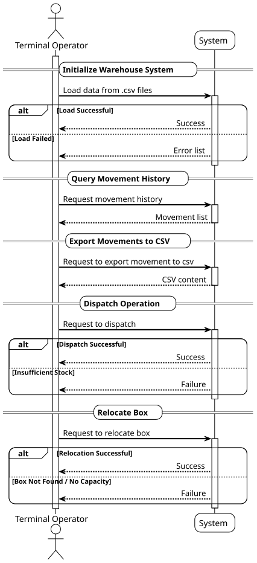

# USEI01 - Wagons Unloading (Inventory Replenishment)

## 1. Requirements Engineering

### 1.1. User Story Description

As a terminal operator, I want unloading of wagons to automatically store inventory using
FEFO and/or FIFO logic, so that I can ensure the correct dispatch order and minimize product spoilage.

### 1.2. Customer Specifications and Clarifications

**From the document specifications:**

> When wagons arrive at the terminal and are unloaded into warehouses, the sequence in which products are stored
and dispatched is critical for maintaining inventory accuracy, traceability, and operational efficiency.
> *Perishable goods* must be handled strictly according to their expiry dates, following the FEFO principle.
This ensures that goods closest to expiration are dispatched first, minimizing spoilage and waste.
> *Non-perishable goods*, without expiry dates, should be managed under a FIFO discipline. This guarantees a fair
rotation of stocks and prevents inventory stagnation. Each item with a unique SKU is stored in boxes, each with a
unique location code (Aisle/Bay) to facilitate picking and restocking. Every movement of goods (whether unloading,
relocation between bays, transfer to another aisle or bay, or final dispatch) is meticulously recorded in a warehouse
management system (WAS). This ensures: 1. Accurate stock tracking by SKU and storage location; 2. Full traceability 
of all cargo throughout the cargo lifecycle in the terminal.

**From the client clarifications:**

> **Question:** To comply with FEFO/FIFO, do we have to treat the entire warehouse as a list, or do we just have to
comply with FEFO/FIFO within each bay? Regarding AC03 I have 2 questions: In what situation will we have to relocate a
box? In the end, it states that we will not have to reorder the bay if the expiration or receipt date does not change.
In what situation can one of these dates change?

> **Answer:** You don’t (and shouldn’t) scan the entire warehouse. FEFO/FIFO is per-SKU across all boxes, but you can
get that in with simple JCF structures—no global full scan. Relocation may be necessary; for example, to consolidate
space, you have the same SKU scattered across many bays; move a box to co-locate and free up a bay (or reduce the
number of partial bays). Those dates shouldn’t change, that’s why you don’t need to reorder a bay when you only
relocate a box. Relocation just updates the location, not the sorting keys (expiry/receivedAt).

---

> **Question:** When the user wants to unload of the wagons to be executed, is it mandatory to be all the wagons,
or can he select which ones to be managed? Can he also select which warehouses are going to store the cargo, or do
all of them count?

> **Answer:** You can make both options: unload all the wagons and permit the selection of which wagons to unload. For the second question, use existing warehouses with a fixed precedence (e.g., warehouseId ASC), filling them to capacity before moving on to the next warehouse.

---

> **Question:** Hi. Are we able to use external libraries that help us with boilerplate code such as Lombok?

> **Answer:** No, you shouldn't use those libraries.

---

> **Question:** Good Afternoon, in the bays.csv file, we only have one warehouse ID. Does that mean that in this
sprint we will manage loading and unloading operations in a single railway terminal? Will every wagon in the
wagons.csv file arrive at that same warehouse?

> **Answer:** We can have several warehouses in a railway terminal.

---

> **Question:** I’ve noticed that some CSV files—such as those from the wagon dataset—use commas (,) as delimiters,
while others—like the bays dataset—use semicolons (;). Could you please confirm which delimiter should be used as the
standard format moving forward?

> **Answer:** You should handle all the files and their delimiters.

---

> **Question:** In this file validation — “Detection of unknown SKUs or wagons not linked to any known product” — we
need to verify the SKUs in the order_lines, returns, and wagons files. We must produce a message for each line where
the SKU doesn’t exist, and if all the SKUs in a wagon don’t match any SKU in file items, we must create another
message right?

> **Answer:** Yes.

---

> **Question:** Could you please clarify how the assignment of aisles and bays to each wagon’s contents is supposed
to be done? Should we follow a specific rule to decide which aisle/bay each box should go?

> **Answer:** You must consider that boxes are atomic; a whole box occupies 1 slot. Never split a box across bays
and never exceed capacityBoxes for that bay. Concerning the waggon’s contents allocation, you can choose how to assign
each incoming box to which aisle/bay, as long as the rule is deterministic and documented in the report.

---

> **Question:** When the system will have more than one warehouseId. It will read/import multiple "bays.csv" files,
each with the info of one warehouse, or it will use a single "bays.csv" file that has the info about all warehouses.
Or it could be a mix of multiple files being imported at different times, each with multiple warehouse info. All the
aisles in the same warehouse must have the same number of bays? Finally, what guarantees do we have about the
"bays.csv" file data?

> **Answer:** A single bays.csv lists all warehouses. Aisles may have different bay counts. Each row must be unique
by (warehouseId, aisle, bay), and include capacityBoxes.

---

> **Question:** Good afternoon! In the previous client meeting, the client has requested that I place my question regarding terminal and warehouse capacity here. Thank you!
"If you try to unload wagons on the warehouses of a terminal, and the warehouse doesn't have the capacity to receive all the boxes, what should happen? The warehouse should receive only a part of the wagon's freight, and the rest would go to another warehouse? And what if the terminal currently doesn't have enough warehouses space to store the wagons' content?"

> **Answer:** The waggon boxes of a train can be stored in more than one warehouse at the same railway station. Use existing warehouses with a fixed precedence (e.g., warehouseId ASC), filling them to capacity before moving on to the next warehouse.
If all the warehouses are full, you must log the wagons that could not be unloaded.

---

> **Question:** Hello, According to the information given in the assignment, it says we should in a Bay respect the FIFO/FEFO. However, since the FIFO/FEFO is global, wouldn't it make much more sense to have a system that just tells you where the next box is according to its SKU, to avoid a Warehouse Manager or a Worker having to pick each box in order to place the boxes on the Bays? Or is it really needed to order by the expiryDate/receivedAt on the Bay itself? (Example: I can receive 3 boxes of apples, 4 boxes of bananas, 5 boxes of pears by this order, and save them by this order on the bays, having a system that tells me the next apple, banana or pear box and where they are, or do I need to place them in order, by SKU and expiryDate on the Bays?). Also, am I supposed to move everything again to the respective places when I get a new unload request if it is the second option?
About the relocation, if we must do it when SKUs are scattered or when almost all the bays are partially filled to fill them and gain space at the end, when is the Relocation triggered. Should a Warehouse Manager ask for it, is it automatic, when exactly is it activated?
Thank you.

> **Answer:** Regarding your first question, you should be the one to decide. Regarding the products in the bays, a bay may contain boxes of different SKUs. The bay’s LinkedList is a single ordered list (by expiry↑, receivedAt↑, boxId↑) across all SKUs.
You do not model physical obstruction within a bay. Think of bays as shelves with direct access to any box by ID. The FEFO order is a preference for which box should be consumed first, not a LIFO/queue constraint. You simply update or remove the target box’s node in the bay list; nothing else moves.
The relocation must be requested.

### 1.3. Acceptance Criteria

> **1. Stock initialization/unloading wagons**
> The file wagons.csv contains the available stock per SKU. Each wagon's contents should be assigned to an aisle/bay,
and their products must be inserted into the correct position inside the bay accordingly to the following rules:
a) boxes are ordered by expiry date (earliest first; null last)
b) receivedAt (oldest first)
c) boxID ASC (tie-break)

> **2. Dispatch operation**
> The operation dispatch must always consume stock from the "front" of the bay list, guaranteeing FEFO/FIFO behaviour.
If a bay becomes empty, it remains in the WMS (the bay still exists), but the box list is empty; only delete empty
boxes, not bays. Partial dispatch across multiple bays must be supported:  if the target bay runs out, continue in the
next bay, ascending number, that holds that SKU.

> **3. Relocation**
> The operation relocation must update a box's warehouseID/aisle/bay only; do not re-sort its new bay if its
expiryDate/receivedAt its unchanged except for inserting it into the new bay's FEFO position.

### 1.4. Found out Dependencies

### 1.5 Input and Output Data

**Input Data:**
- .csv files

### 1.7. System Sequence Diagram (SSD)

The System Sequence Diagram shows the interactions between the Terminal Operator and the System for the main operations of the USEI01:

#### **Main Operations:**

1. **Unload Wagons Operation**:
- CSV data loading
- Data validation
- Unloading wagons into bays
- Processing existing orders

2. **View Movement History**:
- Query movement history
- Display movements with timestamps

3. **Export Movements**:
- Export movements to CSV format
- Generate structured content

4. **Dispatch Operation**:
- Shipment of products following FEFO/FIFO
- Support for partial shipment
- Movement recording

5. **Relocate Box**:
- Relocation of boxes between bays
- Maintenance of FEFO/FIFO order
- Movement recording

#### **System Features:**
- **Strict validation**: Verification of SKUs, date formats, and box uniqueness
- **Full traceability**: All movements are recorded with timestamps
- **Automatic FEFO/FIFO**: Automatic application of business rules
- **Error management**: Detailed error feedback to the operator
- **Data export**: Ability to export transactions to CSV

