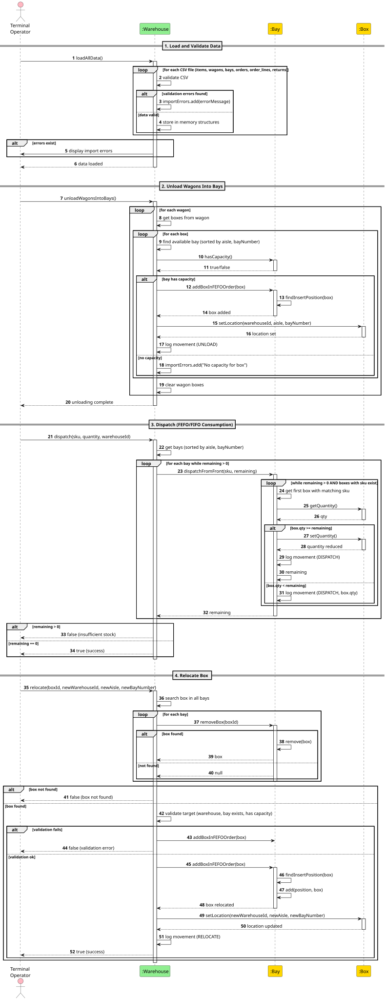
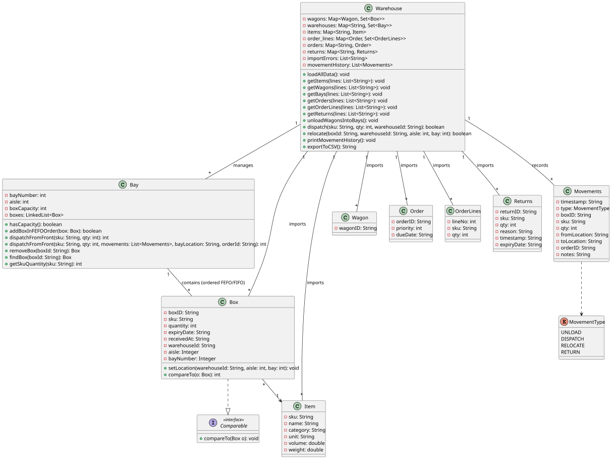

# USEI01 - Wagons Unloading (Inventory Replenishment)

## 3. Design

### Systematization ##

According to the taken rationale, the conceptual classes promoted to software classes are:

* Bay
* Box
* Wagon
* Warehouse

## 3.2. Sequence Diagram (SD)

### Full Diagram

This diagram shows the full sequence of interactions between the classes involved in the realization of this user story.

The Full Sequence Diagram shows all interactions between the USEI01 system classes, including:

#### **Main Classes:**

1. **Warehouse** (Control) - Orchestrates all warehouse operations and business logic
2. **Bay** (Entity) - Storage locations that maintain boxes in FEFO/FIFO order
3. **Box** (Entity) - Product containers with SKU, quantity, expiry date, and location

#### **System Phases:**

##### **1. Data Loading and Validation**
- Loading CSV files (items, wagons, bays, orders, order_lines, returns)
- Validating data integrity:
    - Unique boxId enforcement
    - SKU existence verification
    - Positive quantities
    - Valid date/timestamp formats
    - Required field checks (receivedAt mandatory)
- Storing valid records in memory structures
- Recording validation errors for rejected records

##### **2. Wagon Unloading**
- Distributing boxes from wagons to available bays
- Checking bay capacity before insertion
- **FEFO/FIFO Insertion Rules:**
    1. expiryDate (earliest first, null last)
    2. receivedAt (oldest first)
    3. boxId ASC (tie-breaker)
- Assigning a warehouse location to each box
- Recording UNLOAD movements
- Clearing wagon contents after successful unloading

##### **3. Dispatch Operations (FEFO/FIFO Consumption)**
- Processing dispatch requests by SKU and quantity
- Consuming stock from front of bay (FEFO/FIFO order)
- **Dispatch Behavior:**
    - Reduce box quantity for partial consumption
    - Remove the box entirely when the quantity reaches zero
    - Continue automatically to the next bay if needed
    - Support for multi-bay dispatch
- Recording DISPATCH movements
- Returning success/failure status

##### **4. Box Relocation**
- Searching and removing box from the current location
- Validating the target location:
    - Target warehouse exists
    - Target bay exists
    - Bay has available capacity
- **Fallback mechanism**: Returns box to the original bay if validation fails
- Inserting a box at the correct FEFO position in the target bay
- Updating box location metadata
- Recording RELOCATE movements

#### **Key Features:**

- **FEFO/FIFO Compliance**: Automatic ordering for perishable (earliest expiry first) and non-perishable goods (oldest received first)
- **Full Traceability**: All movements timestamped and recorded in movement history
- **Comprehensive Validation**: Multi-level checks during data import and operations
- **Capacity Management**: Bay capacity verification before any insertion
- **Error Handling**: Clear, deterministic error messages with specific details
- **Bay Persistence**: Empty bays remain in a system after box removal
- **Multi-Warehouse Support**: Operations across multiple warehouse locations
- **Partial Dispatch**: Automatic continuation across multiple bays when needed

#### **Data Flow:**

1. **Input**: CSV files (items.csv, wagons.csv, bays.csv, orders.csv, order_lines.csv, returns.csv)
2. **Validation**: Format checks, SKU verification, uniqueness constraints, business rule validation
3. **Storage**: Boxes organized in bays maintaining strict FEFO/FIFO order
4. **Operations**: Unload → Dispatch → Relocate (all following FEFO/FIFO rules)
5. **Tracking**: Movement history with type, boxId, SKU, quantity, locations, timestamp
6. **Output**: Operation results, movement logs, error reports

#### **Business Rules Enforced:**

- **Box Uniqueness**: No duplicate boxIds in the warehouse
- **SKU Integrity**: All boxes must reference valid items
- **FEFO for Perishables**: Items with expiry dates dispatched in expiry order
- **FIFO for Non-Perishables**: Items without expiry dates dispatched in received order
- **Location Tracking**: Every box knows its current warehouse/aisle/bay location
- **Capacity Limits**: Bays cannot exceed their defined box capacity
- **Movement Audit Trail**: Every operation creates an auditable movement record

### 3.3. Other Observations

This simplified diagram focuses on the core USEI01 functionality, removing unnecessary UI layers to highlight the
essential warehouse management logic. The diagram demonstrates how the Warehouse control class coordinates Bay and
Box entities to implement FEFO/FIFO inventory management, ensuring product quality through proper rotation, full
traceability of all operations, and robust error handling throughout the system lifecycle.

## 3.4. Class Diagram (CD)

