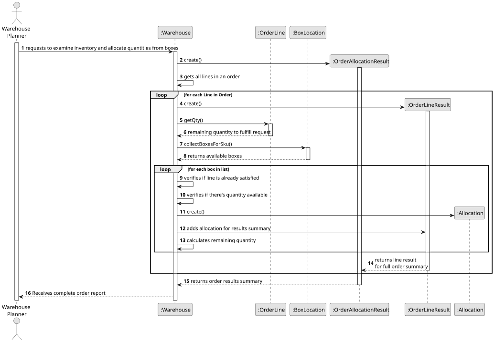
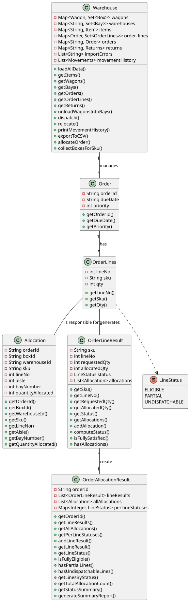

# USEI02 - Order Eligibility & Allocation

## 3. Design

### Systematization ##

According to the taken rationale, the conceptual classes promoted to software classes are:

* Warehouse
* Order
* OrderLine
* OrderLineResult
* OrderAllocationResult

## 3.2. Sequence Diagram (SD)

### Full Diagram

This diagram shows the full sequence of interactions between the classes involved in the realization of this user story.

The Full Sequence Diagram shows all interactions between the USEI02 system classes, including:

#### **Main Classes:**

1. **Warehouse** (Control) - Processes orders and manages inventory allocation
2. **OrderLineResult** (Entity) - Produces per-line results for order processing
3. **OrderAllocationResult** (Entity) - Summarizes overall order allocation status

#### **System Phases:**

##### **1. Order Sorting**
- Sorts orders based on FEFO/FIFO principles
- Prioritizes orders with earliest expiry dates first
- Within same expiry, prioritizes orders with oldest received dates

##### **2. Order Processing**
- Divides each order into individual order lines
- For each order line:
    - Checks SKU availability in the warehouse
    - Allocates stock based on FEFO/FIFO rules
    - Updates inventory levels accordingly
    - Records allocation results in OrderLineResult

##### **3. Summary Report Generation**
- Compiles overall allocation results into OrderAllocationResult
- Indicates whether the entire order was fulfilled or partially fulfilled
- Provides detailed feedback for each order line

#### **Key Features:**

- **FEFO/FIFO Compliance**: Automatic ordering for perishable (earliest expiry first) and non-perishable goods (oldest received first)
- **Detailed Tracking**: Each order line's allocation status is tracked and reported
- **Error Handling**: Manages insufficient stock scenarios gracefully, providing clear feedback

#### **Data Flow:**

1. **Input**: Orders with order lines specifying SKUs and quantities
2. **Processing**: Warehouse checks inventory and allocates stock
3. **Output**: OrderLineResult and OrderAllocationResult summarizing allocation outcomes

#### **Business Rules Enforced:**

- **Box Uniqueness**: No duplicate boxIds in the warehouse
- **SKU Integrity**: All boxes must reference valid items
- **FEFO for Perishables**: Items with expiry dates dispatched in expiry order
- **FIFO for Non-Perishables**: Items without expiry dates dispatched in received order
- **Location Tracking**: Every box knows its current warehouse/aisle/bay location
- **Capacity Limits**: Bays cannot exceed their defined box capacity
- **Movement Audit Trail**: Every operation creates an auditable movement record

### 3.3. Other Observations

This diagram focuses on the core USEI02 functionality, highlighting how the Warehouse class processes orders
and allocates inventory based on FEFO/FIFO principles. The interactions between the Warehouse, OrderLineResult,
and OrderAllocationResult classes demonstrate the system's ability to manage stock allocation while ensuring 
traceability and compliance with business rules.

## 3.4. Class Diagram (CD)

