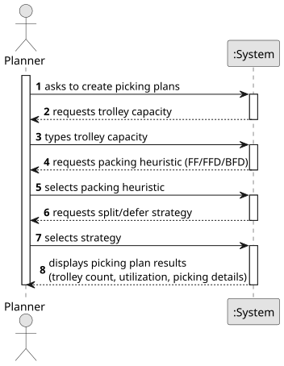

# USEI3 - Picking Plans

## 1. Requirements Engineering

### 1.1. User Story Description
As an Editor, I want to create a map with a size and a name.

### 1.2. Customer Specifications and Clarifications

#### From the customer's clarifications:
> Question: Hello, Regarding this US, it's mentioned in its context, that there are 3 packing heuristics, and in the acceptance criteria, that "The planner must dispatch the orders,
executing any one of the three packing heuristics on the same set of order lines.". However, it doesn't clarify who chooses the option to split or defer the boxes if the trolley runs out of capacity. Is it the goal to just develop one of them at choice (being the developers' choice), or should the "Planner" actor choose it together with the packing heuristics? Thanks

>
> Answer: The three heuristics must be implemented. The choice of each one to use can be parameterised

#### From the specifications document:
- In the warehouse, the following packing heuristics are used:
  - First Fit (FF): Place the item in the first available trolley, where it fits. The
    scan order should be the input order of the allocation rows.
  - First Fit Decreasing (FFD): Sort unpicked allocations from US02 by weight
    from largest to smallest and place the item in the first available batch where
    it fits.
  - Best Fit Decreasing (BFD): Sort all unpicked allocations from US02 by weight,
    from largest to smallest, and put the item into the batch that will result in
    the smallest amount of remaining unused capacity, i.e., the tightest fit.
- If a single order line does not fit in the remaining capacity, either:
  - Split it: put part in the current wave, log a “partial allocation,” and carry the
    remainder to the next trolley; or
  - Defer it entirely: log “skipped due to capacity,” and put the full line in the
    next trolley.

### 1.3. Acceptance Criteria
- **AC1:** There is no limit on the number of trolleys; their capacity should be defined by the planner. 
- **AC2:** The planner must dispatch the orders,
  executing any one of the three packing heuristics on the same set of order lines. 
- **AC3:** For each heuristic, it must be displayed:
  - The total number of trolleys necessary to dispatch the orders;
  - Utilisation of each trolley (usedWeight/capacityWeight, e.g., 85% full);
  - For each trolley, provide the picking plan with all: order ID, line number, aisle,
    bay number, boxId, SKU, quantity.

### 1.4. Found Dependencies
- **USEI2** : This US depends on the allocation rows produced by USEI2, which determines which order lines can be dispatched and allocates concrete quantities from boxes.
- **Items data** : Items data: Weight information from items.csv is required to calculate the weight of each allocation row.
### 1.5. Input and Output Data

#### Input Data:

  - The trolley capacity (in kg);
  - The packing heuristic option (FF,FFD or BFD);
  - The Split/Defer option in case the items don't fit;
  - The allocation rows from USEI2;

#### Output Data:
- For each heuristic executed:
  - The total numbers of trolleys used;
    - Utilization percentage (usedWeight/capacityWeight);
    - Picking plan with: order ID, line number, aisle, bay number, boxId, SKU, quantity;
- Success confirmation message;
- Error messages if issues occur;

### 1.6. System Sequence Diagram (SSD)

**_Other alternatives might exist._**

### 1.7. Other Relevant Remarks
- None.