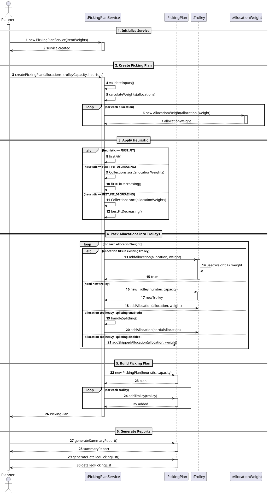
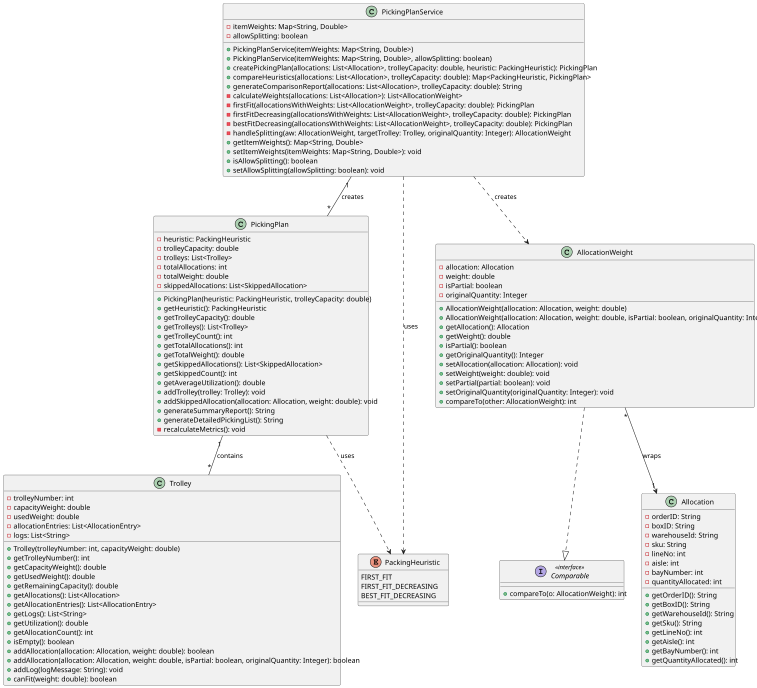

# USEI3 - Picking Plans

## 3. Design

### Systematization ##

According to the taken rationale, the conceptual classes promoted to software classes are:

* AllocationWeight
* PickingPlan
* PickingPlanService
* Trolley

There is also a service class : PackingHeuristic

## 3.2. Sequence Diagram (SD)

### Full Diagram

This diagram shows the full sequence of interactions between the classes involved in the realization of this user story.

The Full Sequence Diagram shows all interactions between the USEI03 system classes, including:

#### **Main Classes:**

1. **PickingPlanService** (Control) - Orchestrates picking plan creation and executes packing heuristics
2. **AllocationWeight** (Value Object) -  Pairs allocations with calculated weights
3. **PickingPlan** (Entity) -  Contains complete picking plan with trolley assignments
4. **Trolley** (Entity) - Represents a physical picking cart with capacity and allocations

#### **System Phases:**

##### **1. Service Initialization**
- Planner creates **PickingPlanService** with item's weights map.
- Service validates if that item's weights map is not null or empty;
- Service stores the type of configuration to use (split or defer it).

##### **2. Picking Plan Creation**
- Planner invokes `createPickingPlan(allocations, trolleyCapacity, heuristic)`
- Service validates inputs
- Service calculates weights for all allocations
- For each allocation:
    - Retrieves unit weight from item weights map
    - Calculates total weight: `unitWeight × quantityAllocated`
    - Creates `AllocationWeight` object

##### **3. Heuristic Application**
Three packing strategies are available:

**First Fit (FF)**:
- Process allocations in input order (no sorting)
- Place each item in first trolley that fits
- Create new trolley if none fit

**First Fit Decreasing (FFD)**:
- Sort allocations by weight (heaviest first)
- Place each item in first trolley that fits
- Create new trolley if none fit

**Best Fit Decreasing (BFD)**:
- Sort allocations by weight (heaviest first)
- Place each item in trolley with tightest fit (minimum remaining space)
- Create new trolley if none fit

##### **4. Allocation Packing**
For each allocation, the service:
- **If fits in existing trolley**:
    - Calls `addAllocation(allocation, weight)` on trolley
    - Trolley updates `usedWeight` and adds allocation entry
- **If no trolley fits and weight ≤ capacity**:
    - Creates new `Trolley` with sequential number
    - Adds allocation to new trolley
- **If weight > capacity and splitting enabled**:
    - Calls `handleSplitting()` method
    - Splits allocation into partial quantities
    - Places what fits in current trolley (marked as PARTIAL)
    - Processes remainder in next iteration
- **If weight > capacity and splitting disabled**:
    - Calls `addSkippedAllocation()` on PickingPlan
    - Allocation logged as skipped

##### **5. Plan Assembly**
- Service creates `PickingPlan` object with selected heuristic and capacity
- Adds all trolleys to the plan using `addTrolley()`
- PickingPlan automatically calculates metrics:
    - Total number of trolleys
    - Total allocations across all trolleys
    - Total weight across all trolleys
    - Average utilization percentage
- Tracks skipped allocations list

##### **6. Report Generation**
- **Summary Report** (`generateSummaryReport()`):
    - Displays heuristic used and trolley capacity
    - Shows total trolley count and skipped allocation count
    - Lists utilization percentage for each trolley
    - Itemizes skipped allocations with box ID, SKU, and weight

- **Detailed Picking List** (`generateDetailedPickingList()`):
    - Groups allocations by trolley number
    - Shows trolley utilization percentage
    - For each allocation displays:
        - Order ID and Line Number
        - Aisle and Bay Number
        - Box ID and SKU
        - Quantity (with PARTIAL indicator if split)
    - Includes skipped allocations section with full details

#### **Key Features:**

- **Multiple Heuristics**: Three bin-packing algorithms (FF, FFD, BFD) with different optimization strategies
- **Smart Splitting**: Optional allocation splitting with full traceability of partial quantities
- **Dynamic Trolleys**: Unlimited trolley creation as needed (no predefined limit)
- **Utilization Tracking**: Real-time efficiency metrics showing percentage of capacity used
- **Capacity Enforcement**: Strict validation ensuring no trolley exceeds weight limit
- **Comprehensive Reporting**: Both summary and detailed picking lists for warehouse operations

#### **Data Flow:**

1. **Input**:
    - Allocations list from USEI02 (order lines with SKU, quantity, location)
    - Trolley capacity in kg
    - Heuristic selection (FIRST_FIT, FIRST_FIT_DECREASING, or BEST_FIT_DECREASING)
    - Item weights map (SKU → unit weight in kg)

2. **Processing**:
    - Weight calculation for all allocations
    - Sorting by weight (for FFD and BFD only)
    - Packing allocations into trolleys using selected heuristic
    - Splitting oversized allocations (if enabled)

3. **Output**:
    - Complete PickingPlan with trolley assignments
    - Utilization metrics for each trolley
    - Summary and detailed reports
    - List of skipped allocations (if any)

#### **Business Rules Enforced:**

- **Weight Integrity**: All SKUs must have weight information in the item weights map
- **Capacity Constraints**: No trolley can exceed its defined weight capacity
- **Unit Weight Limit**: Single unit weight cannot exceed trolley capacity (throws exception)
- **Splitting Traceability**: When enabled, partial allocations maintain original quantity tracking
- **Sequential Processing**: FF maintains input order; FFD/BFD process heaviest items first
- **Best Fit Optimization**: BFD selects trolley with minimum remaining capacity (tightest fit)
- **Complete Audit Trail**: All allocations tracked as placed, partial, or skipped

### 3.3. Other Observations

## 3.4. Class Diagram (CD)

