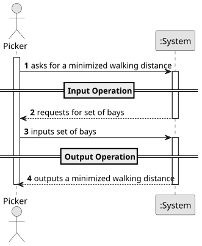

# USEI01 - Minimize Walking Distance

## 1. Requirements Engineering

### 1.1. User Story Description

As a picker, I want to plan the task of picking up several boxes, 
sequenced using a 2D layout (aisles & bays), 
so I minimize walking distance starting from the entrance at the main corridor, 
with no return leg.

### 1.2. Customer Specifications and Clarifications

**From the document specifications:**

> The warehouses are organized in several aisles that are open spaces
between rows of bays, that provide pathways to move goods and access bays —
areas for storing products. A bay location is a coordinate pair (aisle * 3, bay). The
entrance is at coordinate (0,0) on the main corridor.
>

### 1.3. Acceptance Criteria

> **1.** The input is the set of bays from the picking plan generated in the previous
USEI03. Duplicate bays must be merged into a single stop (sum quantities) before
sequencing, otherwise the same bay could appear multiple times in the path. For
a picking plan (set of bays) both strategies must be executed and for each strategy
return the path followed and the total distance.

### 1.4. Found out Dependencies

> Dependency on USEI03.

### 1.5 Input and Output Data

**Input Data:**
- Set of bays from the picking plan generated in the previous USEI03.

### 1.6 System Sequence Diagram (SSD)

The System Sequence Diagram shows the interactions between the Terminal Operator and the System for the main operations of the USEI01:

### 1.7 Other Relevant Remarks
#### **Main Operations:**

1. **Input Operation**
- The Terminal Operator inputs the set of bays from the picking plan generated in the previous USEI03.

2. **Output Operation**
- The System outputs the path followed and the total distance.

