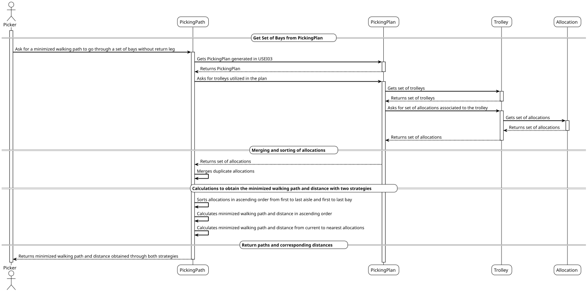
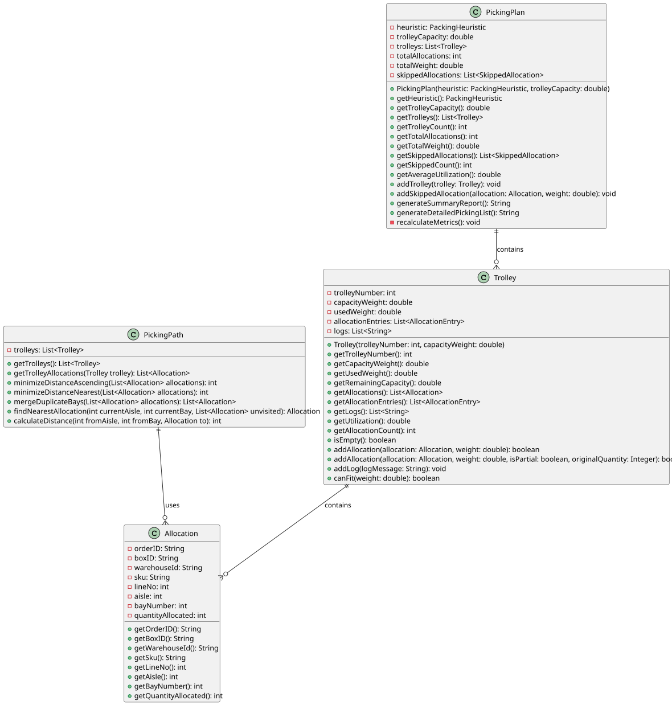

# USEI04 - Minimize Walking Distance

## 3. Design

### Systematization ##

According to the taken rationale, the conceptual classes promoted to software classes are:

* PickingPath

## 3.2. Sequence Diagram (SD)

### Full Diagram

This diagram shows the full sequence of interactions between the classes involved in the realization of this user story.

The Full Sequence Diagram shows all interactions between the USEI01 system classes, including:

#### **Main Classes:**

1. **PickingPath** (Control) - Controller responsible for the calculation of the minimized walking distance/path

#### **System Phases:**

##### **1. Data Loading**
- Loading set of bays utilized in the PickingPlan generated in USEI03

##### **2. Minimize Walking Distance**
- Calculating the minimized walking distance/path
- Returning the result

#### **Key Features:**

- **Ascending Order** - The path is calculated in ascending order
- **Nearest Neighbour** - The path is calculated with the nearest neighbour
- **Merge Duplicates** - Duplicate bays are merged into a single bay
- **Minimized Walking Distance** - The path is calculated with the minimum number of moves

#### **Data Flow:**

1. **Input**: Set of bays utilized in the PickingPlan generated in USEI03
2. **Merge**: Duplicate bays are merged into a single bay
3. **Calculate**: The path is calculated with the minimum number of moves utilizing two different strategies
4. **Output**: Minimized walking distance/path

#### **Business Rules Enforced:**

- **Merge Duplicate Bays**: Duplicate bays should be merged into a single stop
- **Two Strategies**: The minimized walking path should be calculated with two different strategies, showing the results of both.

### 3.3. Other Observations

## 3.4. Class Diagram (CD)

