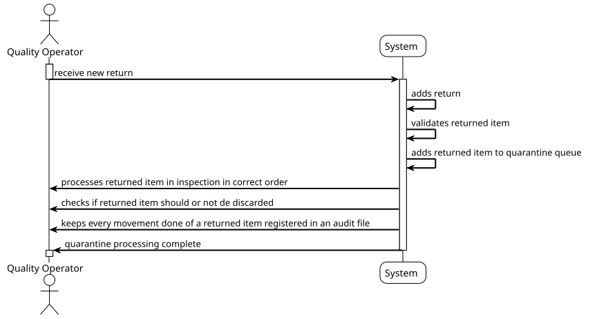

# USEI05 - Returns & Quarantine

## 1. Requirements Engineering

### 1.1. User Story Description

As a quality operator, I want returned goods to be placed in quarantine so that I can inspect them in the reverse order 
they arrived, latest first (descending by timestamp, ties by returnId ASC), process them, either discard or restock 
them, and create an audit file detailing the processing done to each product.

### 1.2. Customer Specifications and Clarifications

**From the document specifications:**

> In a warehouse, returned products cannot immediately re-enter inventory. They must first be placed into quarantine to ensure quality and safety. This step prevents damaged or expired goods from being mixed with usable stock. Quarantined items are inspected in the reverse order they arrived (latest first), because these are usually the most urgent to process. After inspection, items may either be discarded if they are unsuitable or safely restocked back into inventory. To ensure accountability, every inspection action must be written into a log file with the relevant details.

**Reasons for returns:**
- **REMORSE**: The customer returned the item even though it is still in good condition (e.g., unwanted gift, wrong choice). These items can often be restocked.
- **DAMAGED**: The product is physically broken or unusable. These items must be discarded.
- **EXPIRED**: The product has passed its expiry date. These items cannot be sold and must be discarded.
- **CYCLE_COUNT**: A mismatch was found during a stock audit. These items are not faulty but must be rechecked before restocking.

### 1.3. Acceptance Criteria

> **1. Handle customer returns putting them in quarantine first**
> Returned goods must be placed in quarantine before any processing. The quarantine system ensures that returned items are isolated from regular inventory until they can be properly inspected and processed.

> **2. Inspect each return in reverse order of arrival**
> Items in quarantine must be inspected in the reverse order they arrived (latest first, descending by timestamp, ties by returnId ASC). This ensures that the most recently returned items are processed first, as they are usually the most urgent to handle.

> **3. Process returns: either discard or restock**
> After inspection, each return must be either:
> - **Discarded**: If the item is damaged, expired, or otherwise unsuitable for resale
> - **Restocked**: If the item is in good condition and can be safely returned to inventory

> **4. For restocking, create a new box with specific rules**
> When restocking items, create a new box with:
> - boxId = "RET-" + returnId
> - receivedAt = now() (current timestamp)
> - expiryDate as provided or null if unknown
> - Place into appropriate bay using standard FEFO/FIFO insertion rules from USEI01

> **5. Create an audit log for each inspection**
> Each inspection must write a line to an external audit log file with the format:
> ```
> timestamp | returnId=... | sku=... | action=Restocked|Discarded | qty=... (and, if partially restocked, include qtyRestocked and qtyDiscarded)
> ```

> **Example audit log entries:**
> ```
> 2025-09-22 14:32 | returnId=R105 | sku=SKU123 | action=Restocked | qty=8
> 2025-09-22 14:40 | returnId=R106 | sku=SKU200 | action=Discarded | qty=5
> ```

### 1.4. Found out Dependencies

- **USEI01**: Depends on the FEFO/FIFO insertion rules and bay management system for restocking items
- **Returns data**: Requires access to the returns.csv file containing return information
- **Items data**: Requires access to the items.csv file for SKU validation
- **Bays data**: Requires access to the bays.csv file for proper box placement

### 1.5. Input and Output Data

**Input Data:**
- returns.csv file containing return information
- items.csv file for SKU validation
- bays.csv file for bay capacity and location information
- Current warehouse state (bays with existing boxes)

**Output Data:**
- Audit the log file with inspection details
- Updated warehouse state (new boxes in bays for restocked items)
- Discarded items (removed from a system)

### 1.6. System Sequence Diagram (SSD)



The System Sequence Diagram shows the interactions between the Quality Operator and the System for the main operations of the USEI05:

#### **Main Operations:**

1. **Process Returns in Quarantine**:
   - Load returns data from CSV
   - Sort returns by timestamp (latest first)
   - Process each return in order

2. **Inspect Return**:
   - Examine return details
   - Determine return reason
   - Make a decision: discard or restock

3. **Discard Return**:
   - Mark an item as discarded
   - Log discard action to audit a file
   - Remove from quarantine

4. **Restock Return**:
   - Create a new box with RET-prefix
   - Apply FEFO/FIFO insertion rules
   - Place in the appropriate bay
   - Log restock action to audit a file

5. **Generate Audit Log**:
   - Create timestamped log entries
   - Include return details and actions taken
   - Export to external audit file

#### **System Features:**
- **Quarantine Management**: Isolated processing of returned items
- **Reverse Order Processing**: Latest returns processed first
- **Quality Control**: Inspection before restocking
- **Audit Trail**: Complete logging of all inspection actions
- **FEFO/FIFO Compliance**: Proper insertion of restocked items
- **Error Handling**: Validation of return data and bay capacity