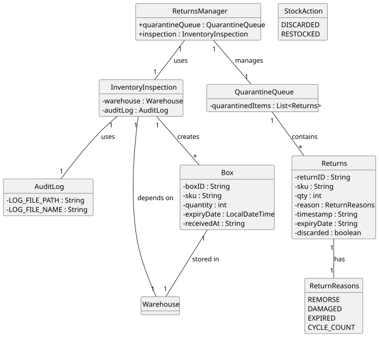

# USEI05 - Returns & Quarantine

## 2. Analysis

### 2.1. Relevant Domain Model Excerpt

### 2.2. Domain Model Description

The domain model for USEI05 focuses on the quarantine and returns processing system. The key entities and their relationships are:

#### **Core Entities:**

1. **Returns**: Represents returned items that need to be processed
   - returnID: Unique identifier for the return
   - sku: Product SKU being returned
   - qty: Number of items returned
   - reason: Reason for return (ReturnReasons enum: REMORSE, DAMAGED, EXPIRED, CYCLE_COUNT)
   - timestamp: When the return was received (String format)
   - expiryDate: Expiration date of the returned item (String format, nullable)
   - discarded: Boolean flag indicating if item was discarded

2. **QuarantineQueue**: Container for returned items awaiting inspection
   - quarantinedItems: List of Returns objects
   - Manages the isolation of returned items
   - Maintains order of items for inspection (latest first, then by returnID ASC)
   - Tracks inspection status

3. **InventoryInspection**: Process of examining returned items
   - warehouse: Reference to warehouse for restocking
   - auditLog: Reference to audit logging system
   - Determines if item should be discarded or restocked
   - Records inspection decisions
   - Links to audit logging

4. **AuditLog**: Records all inspection actions
   - LOG_FILE_PATH: Path to audit log file
   - LOG_FILE_NAME: Name of audit log file
   - timestamp: When the action occurred
   - returnID: Reference to the return
   - sku: Product SKU
   - action: Type of action (StockAction enum: DISCARDED, RESTOCKED)
   - qty: Quantity involved
   - Additional fields for partial processing (qtyRestocked, qtyDiscarded)

5. **ReturnsManager**: Main controller for returns processing
   - quarantineQueue: Manages quarantine operations
   - inspection: Handles inspection logic
   - Coordinates the entire returns workflow

6. **ReturnReasons**: Enum for return reasons
   - REMORSE: Customer remorse returns
   - DAMAGED: Damaged products
   - EXPIRED: Expired products
   - CYCLE_COUNT: Cycle count discrepancies
   - Methods: shouldBeDiscarded(), shouldBeRestocked(), parse()

7. **StockAction**: Enum for stock actions
   - DISCARDED: Item was discarded
   - RESTOCKED: Item was restocked

8. **Box**: Container for restocked items (extends from USEI01)
   - boxId: Unique identifier (prefixed with "RET-" for returns)
   - receivedAt: Timestamp when restocked
   - expiryDate: Expiration date
   - Follows FEFO/FIFO rules for placement

#### **Key Relationships:**

- **Returns → QuarantineQueue**: Returns are placed in quarantine for inspection
- **QuarantineQueue → InventoryInspection**: Quarantine items are processed through inspection
- **InventoryInspection → AuditLog**: All inspection actions are logged
- **InventoryInspection → Box**: Approved items become new boxes for restocking
- **Box → Bay**: Restocked boxes are placed in warehouse bays following FEFO/FIFO rules
- **ReturnsManager → QuarantineQueue**: ReturnsManager coordinates quarantine operations
- **ReturnsManager → InventoryInspection**: ReturnsManager coordinates inspection process
- **Returns → ReturnReasons**: Returns have a reason from the ReturnReasons enum
- **AuditLog → StockAction**: Audit log entries reference stock actions

#### **Business Rules:**

1. **Quarantine Order**: Items are processed in reverse chronological order (latest first)
2. **Inspection Decision**: Items are either discarded or restocked based on condition
3. **Restock Rules**: Restocked items follow standard FEFO/FIFO insertion rules
4. **Audit Trail**: All actions must be logged with complete details
5. **Box Naming**: Restocked boxes use "RET-" prefix + returnId
6. **Timestamp Management**: Restocked items use current timestamp as receivedAt

### 2.3. Other Remarks

The quarantine system ensures quality control by preventing potentially damaged or expired items from immediately re-entering the regular inventory. The reverse order processing (latest first) prioritizes recently returned items, which are typically more urgent to process. The audit logging provides complete traceability for compliance and quality assurance purposes.

The integration with the existing warehouse system (USEI01) ensures that restocked items follow the same FEFO/FIFO rules as regular inventory, maintaining consistency in inventory management practices.