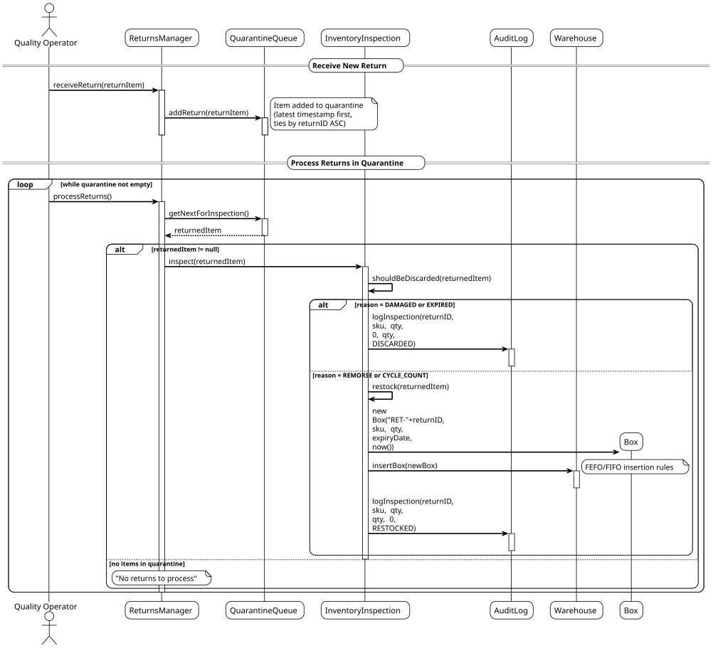
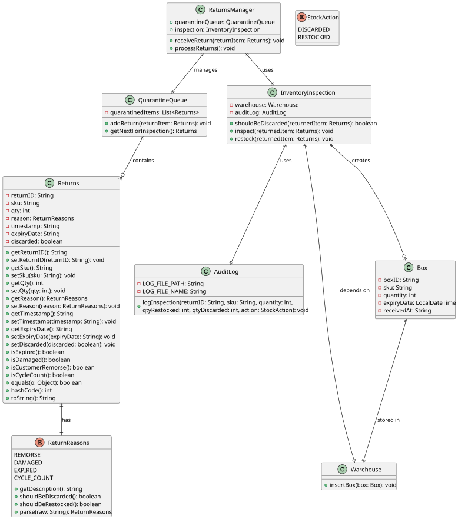

# USEI05 - Returns & Quarantine

## 3. Design

### 3.1. Systematization

According to the taken rationale, the conceptual classes promoted to software classes are:

* **ReturnsManager** - Main controller for returns processing workflow
* **QuarantineQueue** - Manages the quarantine queue and item ordering
* **InventoryInspection** - Handles the inspection logic and decision making
* **AuditLog** - Handles audit logging functionality
* **Returns** - Entity representing returned items
* **ReturnReasons** - Enum for return reason types
* **StockAction** - Enum for stock action types

### 3.2. Sequence Diagram (SD)

#### Full Diagram

This diagram shows the full sequence of interactions between the classes involved in the realization of this user story.

The Full Sequence Diagram shows all interactions between the USEI05 system classes, including:

#### **Main Classes:**

1. **ReturnsManager** (Control) - Main controller for returns processing workflow
2. **QuarantineQueue** (Control) - Manages the quarantine queue and item ordering
3. **InventoryInspection** (Control) - Manages inspection logic and quality control decisions
4. **AuditLog** (Control) - Handles audit logging and file management
5. **Returns** (Entity) - Represents returned items with all relevant data
6. **ReturnReasons** (Enum) - Defines return reason types and business logic
7. **StockAction** (Enum) - Defines stock action types

#### **System Phases:**

##### **1. Quarantine Initialization**
- Loading returns data from CSV files
- Validating return data integrity:
    - Unique returnId enforcement
    - SKU existence verification
    - Valid timestamps and dates
    - Reason validation (customer_remorse, damaged, expired, cycle_count)
- Sorting returns by timestamp (descending - latest first)
- Creating quarantine queue for processing

##### **2. Return Processing Loop**
- Processing returns in reverse chronological order
- For each return:
    - Retrieving return details (returnId, sku, quantity, reason, timestamp, expiryDate)
    - Determining return reason and condition
    - Making inspection decision based on business rules

##### **3. Inspection Decision Making**
- **Customer Remorse**: Usually suitable for restocking
- **Damaged**: Must be discarded
- **Expired**: Must be discarded
- **Cycle Count**: Requires rechecking, may be restocked
- Creating InspectionResult with decision and quantities

##### **4. Restock Processing**
- Creating new box with "RET-" prefix + returnId
- Setting receivedAt to current timestamp
- Using provided expiryDate or null if unknown
- Finding appropriate bay using FEFO/FIFO rules from USEI01
- Inserting box into bay maintaining FEFO/FIFO order
- Recording RESTOCK movement in audit log

##### **5. Discard Processing**
- Marking item as discarded
- Recording DISCARD action in audit log
- Removing from quarantine queue
- No physical box creation (item is removed from system)

##### **6. Audit Logging**
- Creating timestamped audit entries for all actions
- Log format: `timestamp | returnId=... | sku=... | action=Restocked|Discarded | qty=...`
- Supporting partial processing with qtyRestocked and qtyDiscarded
- Exporting audit log to external file

#### **Key Features:**

- **Quarantine Management**: Isolated processing of returned items with proper ordering
- **Quality Control**: Comprehensive inspection process with business rule enforcement
- **Audit Trail**: Complete logging of all inspection actions with timestamps
- **FEFO/FIFO Compliance**: Proper integration with existing warehouse rules
- **Error Handling**: Validation of return data and business rule enforcement
- **Reverse Order Processing**: Latest returns processed first for urgency
- **Flexible Decision Making**: Support for different return reasons and outcomes

#### **Data Flow:**

1. **Input**: Returns CSV file with return information
2. **Validation**: Format checks, SKU verification, reason validation, timestamp validation
3. **Quarantine**: Items sorted by timestamp (descending) and queued for processing
4. **Inspection**: Each item examined and decision made based on return reason
5. **Processing**: Items either restocked (new boxes) or discarded (removed)
6. **Audit**: All actions logged with complete details
7. **Output**: Updated warehouse state, audit log file, processed returns

#### **Business Rules Enforced:**

- **Return Ordering**: Latest returns processed first (reverse chronological order)
- **Quality Control**: Damaged and expired items must be discarded
- **Restock Rules**: Only suitable items can be restocked
- **Box Naming**: Restocked boxes use "RET-" prefix + returnId
- **FEFO/FIFO Compliance**: Restocked items follow standard warehouse rules
- **Audit Requirements**: All actions must be logged with timestamps
- **Reason Validation**: Only valid return reasons are accepted
- **Timestamp Management**: Current timestamp used for restocked items

### 3.3. Class Diagram (CD)

### 3.4. Other Observations

This design focuses on the core USEI05 functionality, providing a comprehensive quarantine and returns processing system. The design demonstrates how the QuarantineManager coordinates with ReturnsProcessor, InspectionService, and AuditLogger to implement quality control through proper quarantine management, complete audit trail maintenance, and robust error handling throughout the returns processing lifecycle.

The integration with the existing warehouse system (USEI01) ensures that restocked items follow the same FEFO/FIFO rules as regular inventory, maintaining consistency in inventory management practices while providing the necessary quality control for returned items.