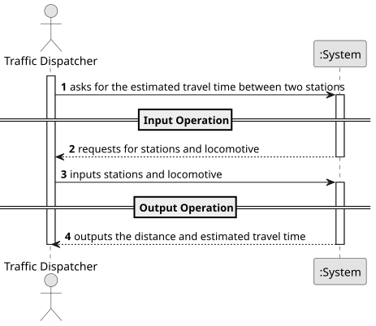

# USLP03 - Estimate Travel Time

## 1. Requirements Engineering

### 1.1. User Story Description

As a Traffic Dispatcher, I want to calculate the estimated travel time
between two stations, with a direct connection between them, and a selected
locomotive.

### 1.2. Customer Specifications and Clarifications

### 1.3. Acceptance Criteria

> **1.** In this version, acceleration can be assumed to be
instantaneous. When presenting the results, the sections should be listed in
the order in which they will be covered, and the speed should be considered
in the calculation of the trip.

### 1.4. Found out Dependencies

> None.

### 1.5 Input and Output Data

**Input Data:**
- Stations.
- Locomotive.

### 1.6 System Sequence Diagram (SSD)

The System Sequence Diagram shows the interactions between the Terminal Operator and the System for the main operations of the USEI01:

### 1.7 Other Relevant Remarks
#### **Main Operations:**

1. **Input Operation**
- The Traffic Dispatcher inputs the stations and locomotive.

2. **Processing Operation**
- The System obtains the distance between the stations.
- The System calculates the estimated travel time.

3. **Output Operation**
- The System outputs the estimated travel time.