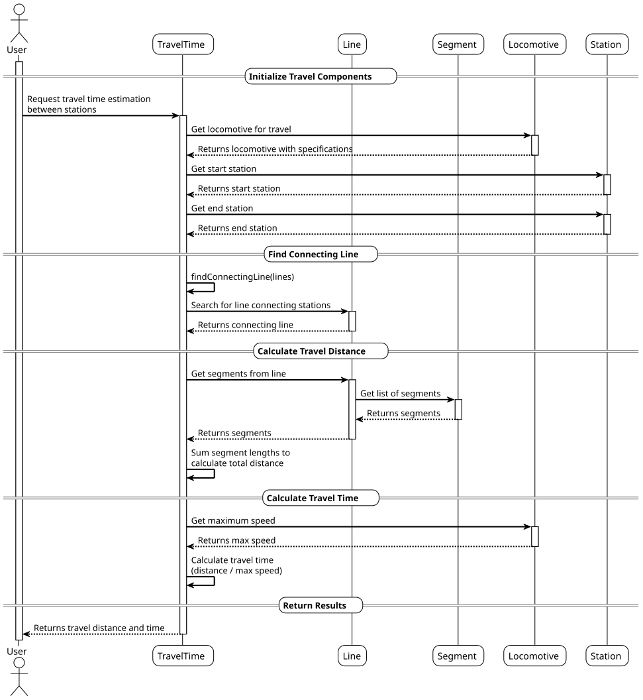
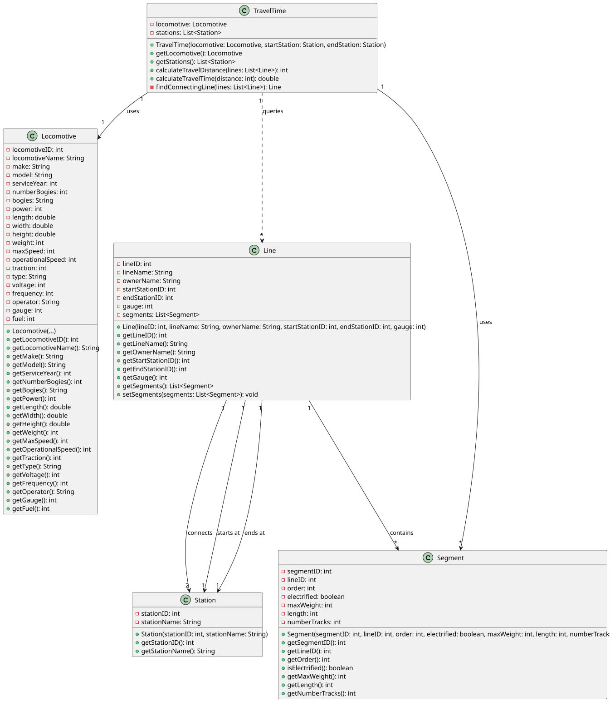

# USLP03 - Estimate Travel Time

## 3. Design

### 3.1. Systematization

According to the taken rationale, the conceptual classes promoted to software classes are:

* TravelTime
* Locomotive
* Station
* Line
* Segment

## 3.2. Sequence Diagram (SD)

### Full Diagram

This diagram shows the full sequence of interactions between the classes involved in the realization of this user story.

The Full Sequence Diagram shows all interactions between the USLP03 system classes, including:

#### **Main Classes:**

1. **TravelTime** (Control) - Controller responsible for calculating travel distance and time between stations
2. **Locomotive** (Entity) - Represents the locomotive with its specifications
3. **Station** (Entity) - Represents railway stations
4. **Line** (Entity) - Represents railway lines connecting stations
5. **Segment** (Entity) - Represents individual segments that compose a line

#### **System Phases:**

##### **1. Initialization**
- Obtaining the locomotive to be used for travel
- Identifying start and end stations
- Retrieving available railway lines

##### **2. Find Connecting Line**
- Searching for a direct line that connects the two stations
- Validating that a connection exists

##### **3. Calculate Travel Distance**
- Retrieving all segments that compose the connecting line
- Summing the lengths of all segments to obtain total distance

##### **4. Calculate Travel Time**
- Using the locomotive's maximum speed
- Computing travel time based on distance and speed

#### **Key Features:**

- **Direct Connection Validation** - Ensures a direct line exists between stations
- **Bidirectional Line Search** - Supports lines in both directions
- **Segment Aggregation** - Sums all segment lengths for total distance
- **Speed-Based Calculation** - Uses locomotive's maximum speed for time estimation

#### **Data Flow:**

1. **Input**: Locomotive, start station, end station, and available lines
2. **Search**: Find the line connecting the two stations
3. **Aggregate**: Sum segment lengths to calculate total distance
4. **Calculate**: Compute travel time using distance and locomotive speed
5. **Output**: Travel distance (meters) and travel time (hours)

#### **Business Rules Enforced:**

- **Direct Connection Required**: Only direct lines between stations are considered
- **Maximum Speed Usage**: Travel time is calculated using the locomotive's maximum speed
- **Complete Segment Coverage**: All segments in the line must be included in distance calculation

### 3.3. Other Observations

The system assumes:
- Distance is measured in meters
- Speed is measured in kilometers per hour
- Time is returned in hours
- Lines can be traversed in both directions (bidirectional)

## 3.4. Class Diagram (CD)

The Class Diagram shows the relationships between:
- **TravelTime** uses a **Locomotive** and multiple **Segments**
- **TravelTime** queries **Lines** to find the connecting route
- **Line** contains multiple **Segments** and connects two **Stations**
- **Line** references start and end **Stations** by their IDs