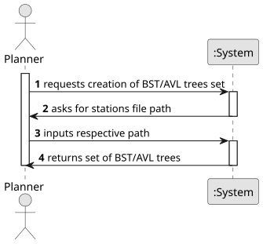

# USEI06 - Time-Zone Index and Windowed Queries

## 1. Requirements Engineering

### 1.1. User Story Description
As a planner, I want a set of BST/AVL trees that lets me quickly search by: latitude, longitude and time zone group and country,
so I can efficiently retrieve all stations of a time zone group by ascending order of country or in a window of time zone groups,
such as ['CET', 'WET/GMT'].

### 1.2. Customer Specifications and Clarifications

#### From the customer's clarifications:
> Question: Hello, 
> In the provided 64k Europe Stations Dataset, there are some Stations only differing on the Booleans at the end (is_city,is_main_station,is_airport). However, on the Acceptance Criteria, they only define the comparisons between the latitude/longitude and name, or timezone/country and name.
> 1. How do we act in this situation? What would be the next comparison, which of the booleans?
> 2. Also, the isCity and isAirport, by searching the file, are exclusive between one another, so can we assume that if it isn't a City Station it is an Airport Station?
> Example:
> country,time_zone,time_zone_group,station,latitude,longitude,is_city,is_main_station,is_airport 
> FR,"('Europe/Paris',)",CET,Chateau-Gontier,47.85,-0.95,True,False,False
> FR,"('Europe/Paris',)",CET,Chateau-Gontier,47.85,-0.95,False,True,False
> FR,"('EuropeParis',)",CET,Crancey,48.516667,3.633333,False,False,False
> FR,"('Europe/Paris',)",CET,Crancey,48.516667,3.633333,True,False,False
> FR,"('Europe/Paris',)",CET,Creutzwald,49.2,6.683333,False,False,False
> FR,"('Europe/Paris',)",CET,Creutzwald,49.2,6.683333,True,False,False 
> Thanks!
>
> Answer: 

> Question: Good afternoon, in the CSV file there are a lot of stations that do not have a latitude and longitude. 
> How should this be handled? 
> We thought about a few possible options, but wanted to check what it's supposed to be like. For example we could set latitude and longitude as 0.0 or with a real coordinates. Another option would be to skip these stations and don't create these at all. 
> Thank you in advance & best regards. 
> Enya Finke
>
> Answer: You can not consider those stations.

#### From the specifications document:
- Context: Planners need fast, reproducible lookups of stations by time zone group, and convenient searches 
by station name and country without scanning the 64k-row CSV.

### 1.3. Acceptance Criteria
- **AC1:** Validate non-empty name stations, countries and time zone groups.
- **AC2:** Validate latitude and longitude intervals.
- **AC3:** Sort stations by name in ascending order if these have the same coordinates.

### 1.4. Found Dependencies
- None

### 1.5. Input and Output Data

#### Input Data:
- Stations File

#### Output Data:
- Set of BST/AVL trees

### 1.6. System Sequence Diagram (SSD)

**_Other alternatives might exist._**

### 1.7. Other Relevant Remarks
- None.