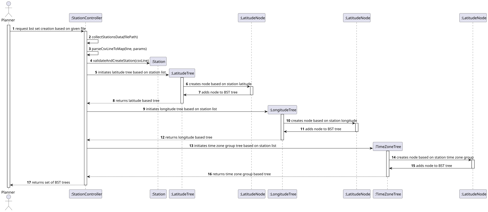
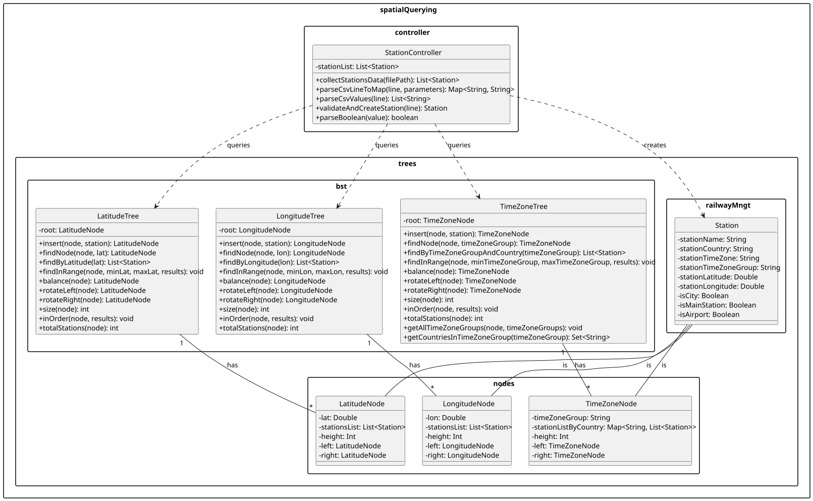

# USEI06 - Time-Zone Index and Windowed Queries

## 3. Design

### Systematization ##

According to the taken rationale, the conceptual classes promoted to software classes are:

* StationController;
* LatitudeTree;
* LatitudeNode;
* LongitudeTree;
* LongitudeNode;
* TimeZoneTree;
* TimeZoneNode;

## 3.2. Sequence Diagram (SD)

### Full Diagram

This diagram shows the full sequence of interactions between the classes involved in the realization of this user story.

The Full Sequence Diagram shows all interactions between the USEI06 system classes, including:

#### **Main Classes:**

1. **StationController** (Control) - Orchestrates the BST trees creation
2. **LatitudeTree** (Data Structure) -  One of the main data structures.
3. **LongitudeTree** (Data Structure) - One of the main data structures.
4. **TimeZoneTree** (Data Structure) - One of the main data structures.

#### **System Phases:**

##### **1. Building Initialization**
- Planner invokes `collectStationsData(filePath)` on the Controller.
- The Controller validates input and initializes the Trees and Nodes.

##### **2. Building Process**
- Controller initiates trees and nodes (Stations), and insert each node in the respective tree.
- At the end, the controller makes sure the tree is balanced.

##### **3. Result**
- Once the building completes, the Controller returns information needed for the planner to make searches.

### 3.3. Other Observations
None.

## 3.4. Class Diagram (CD)

