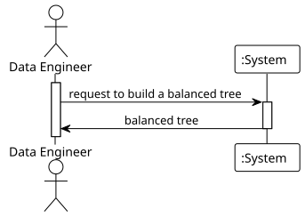

# USEI07 — Build a Balanced 2D-Tree on Latitude and Longitude

## 1. Requirements Engineering

### 1.1. User Story Description
> **As a data engineer, I want to build a balanced 2D-tree using (lat, lon)
so that range and proximity searches run efficiently and deterministically.**

---

### 1.2. Customer Specifications and Clarifications

**From the document specifications:**
We need a spatial index over 64k (approximately) European train stations to enable
fast geographical queries. A KD-tree (k = 2) on (latitude, longitude) supports range and
nearest-neighbor operations much faster than scanning all stations.

---

### 1.3. Acceptance Criteria

**1. Bulk Build:** The simplest way to ensure a balanced 2D-tree is to perform a bulk build. For this, develop
a balanced build strategy that will use the BST/AVL of latitude and longitude created in USEI06
to efficiently construct the 2D-tree.

**2. Preserve Stations:** If multiple stations share the same coordinates, such as (38.71387, -9.122271), which are linked
to Lisbon Santa Apolónia and Lisbon Oriente, the 2D-tree must preserve all these stations by name
in ascending order.

---

### 1.4. Found out Dependencies
This user story depends on the implementation of [**USEI06 - Time-Zone Index and Windowed Queries**](../..//usei06/01.requirements-engineering/ReadMe.md).

**Specific Dependencies:**
- `LatitudeTree` with `inOrderTraversal()` method
- `LongitudeTree` with `inOrderTraversal()` method
- `Station` objects with latitude, longitude, and name attributes

---

### 1.5 Input and Output Data

**Input Data:**
- List of Station objects from CSV files
- LatitudeTree (AVL tree sorted by latitude from USEI06)
- LongitudeTree (AVL tree sorted by longitude from USEI06)

**Output Data:**
- Balanced 2D-tree structure with KDNode objects
- Tree metrics:
    - Size (number of unique coordinate points)
    - Height (maximum depth from root to leaf)
    - Bucket size distribution (Map<bucketSize, count>)
- Statistics:
    - Total nodes
    - Maximum bucket size
    - Minimum bucket size
    - Average bucket size

**Time Complexity:**
- Build: O(n log n) where n = number of unique points
- Sort via AVL traversal: O(n)
- Partitioning: O(n) per level × O(log n) levels = O(n log n)

---

### 1.6. Non-Functional Requirements

**Performance:**
- Build time complexity: O(n log n) overall
    - Grouping: O(m) where m = total stations
    - Sorting via AVL: O(n) where n = unique points
    - Recursive partitioning: O(n log n)
- Space complexity: O(n + m)
    - Tree structure: O(n) nodes
    - Station buckets: O(m) total stations
- Tree height: O(log n) when perfectly balanced

**Correctness:**
- Tree must alternate splitting dimensions at each level
- Median-based partitioning ensures balanced structure
- Duplicate coordinates must be handled in single nodes
- Stations within buckets must maintain alphabetical order

**Maintainability:**
- Clear separation between coordinate uniqueness (Point2D) and station data
- Recursive algorithm follows the standard KD-tree construction pattern
- Metrics calculation separated from tree building logic

---

### 1.7. System Sequence Diagram (SSD)

The system sequence diagram shows the interaction between the data engineer and the system:

