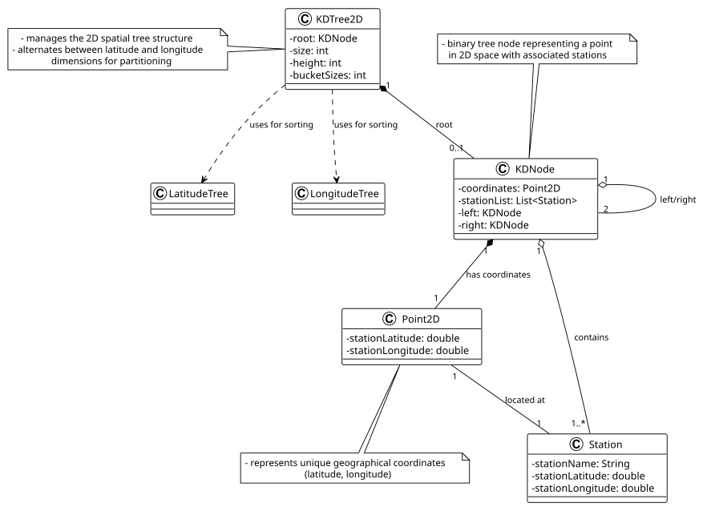

# USEI07 - Build a Balanced 2D-Tree on Latitude and Longitude

## 2. Analysis (Domain Model)

### Domain Concepts

**KDTree2D:**
- Manages the 2D spatial tree structure
- Uses AVL trees from USEI06 to obtain sorted coordinate lists
- Alternates between latitude and longitude dimensions for partitioning
- Tracks tree metrics (size, height, bucket distribution)

**KDNode:**
- Binary tree node representing a unique point in 2D space
- Contains a bucket of stations at that coordinate
- Left/right children form spatial subdivision
- Maintains alphabetical order of stations in bucket

**Point2D:**
- Immutable representation of geographical coordinates (latitude, longitude)
- Used as a map key for grouping stations
- Implements equals() and hashCode() for correct map behavior

**Station:**
- Railway station with name and geographical location
- Multiple stations can share the same coordinates
- Referenced by Point2D in the grouping phase

**LatitudeTree & LongitudeTree:**
- AVL trees from USEI06 containing all stations
- Provide O(n) sorted traversal via inOrderTraversal()
- Used to efficiently sort unique points without comparison sorting