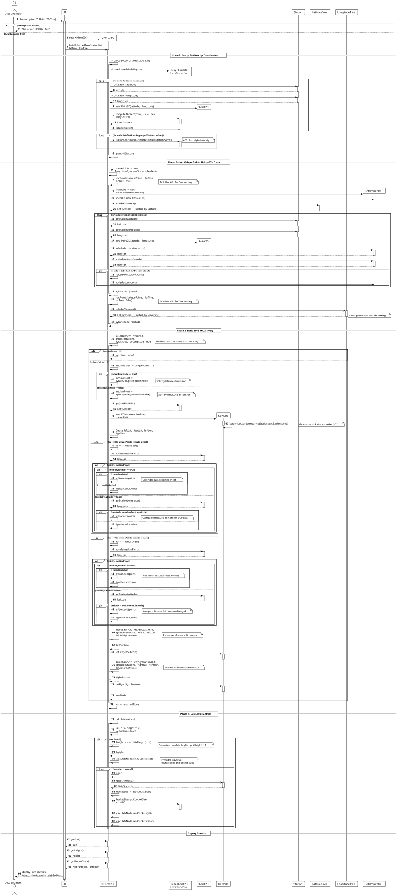
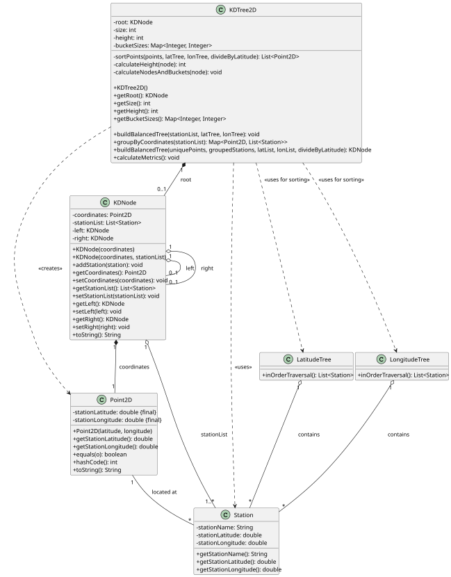

# USEI07 — Build a Balanced 2D-Tree on Latitude and Longitude

## 3. Design

### 3.1. Rationale

The design follows the standard KD-tree construction algorithm with optimizations
leveraging the pre-computed AVL trees from USEI06:

**Key Design Decisions:**

1. **AVL-Based Sorting (AC1):**
    - Uses `sortPoints()` method to leverage AVL trees
    - Performs in-order traversal: O(n) instead of O(n log n) sort
    - Maintains separate sorted lists for latitude and longitude

2. **Duplicate Coordinate Handling (AC2):**
    - Groups stations by Point2D coordinates before building tree
    - Stores multiple stations in single KDNode as a bucket
    - Maintains alphabetical order within each bucket

3. **Median-Based Partitioning:**
    - Selects median point from sorted list (guaranteed balance)
    - Alternates split dimension at each recursion level
    - Maintains two sorted lists (byLatitude, byLongitude) throughout recursion

4. **Dual-List Partitioning:**
    - Partitions both latitude and longitude lists at each step
    - When splitting by latitude: uses index for latList, comparison for lonList
    - When splitting by longitude: uses index for lonList, comparison for latList
    - Ensures both lists remain properly sorted in their respective dimensions

---

### 3.2. Systematization 

According to the taken rationale, the conceptual classes promoted to software classes are:
- `KDNode.java` - Binary tree node with coordinate bucket
- `Point2D.java` - Immutable 2D coordinate
- `KDTree2D.java` - Main tree structure with build algorithm

**Additional Design Patterns:**
- **Composite Pattern:** KDNode forms recursive tree structure
- **Builder Pattern:** Multi-step construction (group → sort → partition → build)
- **Strategy Pattern:** Dimension alternation (latitude vs longitude comparison)

---

## 3.3. Sequence Diagram (SD)

### Full Diagram

This diagram shows the full sequence of interactions between the classes involved in the realization of this user story.

**Key Phases:**
1. **Grouping:** Consolidate stations with duplicate coordinates
2. **Sorting:** Use AVL trees to obtain sorted point lists (O(n))
3. **Building:** Recursive median-based partitioning (O(n log n))
4. **Metrics:** Calculate tree statistics (O(n))

---

## 3.4. Class Diagram (CD)

**Class Responsibilities:**

**KDTree2D:**
- Public API for tree construction and metrics
- Coordinates the build process
- Delegates to helper methods for sorting and partitioning

**KDNode:**
- Stores coordinate and station bucket
- Maintains tree structure (left/right children)
- Ensures stations remain alphabetically sorted

**Point2D:**
- Value object for coordinates
- Implements equals/hashCode for use as Map key
- Immutable to prevent coordinate modification

**Station:**
- Domain entity representing railway station
- Provides coordinate getters for Point2D creation