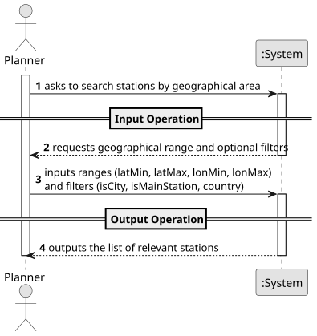

# USEI08 - Search by Geographical Area

## 1. Requirements Engineering

### 1.1. User Story Description

As a planner, I want to query the 2D-tree for all stations in a latitude/longitude range with optional filters, so I can extract relevant stations quickly.

### 1.2. Customer Specifications and Clarifications

**From the document specifications:**

> **Context:** Operations need to list all stations inside a map rectangle, optionally filtered by type or country. KD-tree pruning should avoid scanning the whole dataset.
> **Acceptance Criteria:** The region is defined by: lat ∈ [latMin, latMax], lon ∈ [lonMin, lonMax] (inclusive).

### 1.3. Acceptance Criteria

> **1.** The search must allow the definition of a geographical region (latitude and longitude ranges).
> **2.** The search should allow the optional application of filters with the following criteria:
>    - **isCity** (true | false)
>    - **isMainStation** (true | false)
>    - **country** (PT | ES | all)
       > **3.** The system must return a list of stations that match the coordinates and the applied filters.
       > **4.** The solution should provide 3-5 sample queries and temporal analysis complexity.

### 1.4. Found out Dependencies

> Dependency on the structure **KDTree2D** to perform the spatial search efficiently.

### 1.5 Input and Output Data

**Input Data:**
- **Geographical Range:**
    - Latitude Minimum (`latMin`)
    - Latitude Maximum (`latMax`)
    - Longitude Minimum (`lonMin`)
    - Longitude Maximum (`lonMax`)
- **Optional Filters** (as per `GeographicalSearch` class):
    - `Boolean isCity`
    - `Boolean isMainStation`
    - `String country`

**Output Data:**
- A list of stations (`List<Station>`) that fall within the specified boundaries and match the filters.

### 1.6 System Sequence Diagram (SSD)

The System Sequence Diagram shows the interactions between the Planner and the System for the main operations of USEI08.

### 1.7 Other Relevant Remarks

#### **Main Operations:**

1. **Input Operation**
    - The Planner inputs the geographical boundaries (latitude/longitude ranges) and selects optional filters (City, Main Station, Country).

2. **Output Operation**
    - The System processes the query using the KD-Tree and outputs the filtered list of stations found in that area.