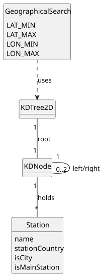

# USEI08 - Search by Geographical Area

## 2. Analysis

### 2.1. Relevant Domain Model Excerpt

### 2.2. Other Remarks

**Algorithmic Considerations:**
To fulfill the requirement of avoiding a full dataset scan, the system uses a **KD-Tree (2-Dimensional)**. This structure allows for efficient range searches (pruning) based on geographical coordinates (latitude and longitude).

**Filter Logic:**
As seen in the `GeographicalSearch` class and requirements, the search returns `Station` objects which are then filtered in memory based on:
* **Type:** City (`isCity`) or Main Station (`isMainStation`).
* **Location:** Specific Country code (e.g., "PT", "ES") or "all".