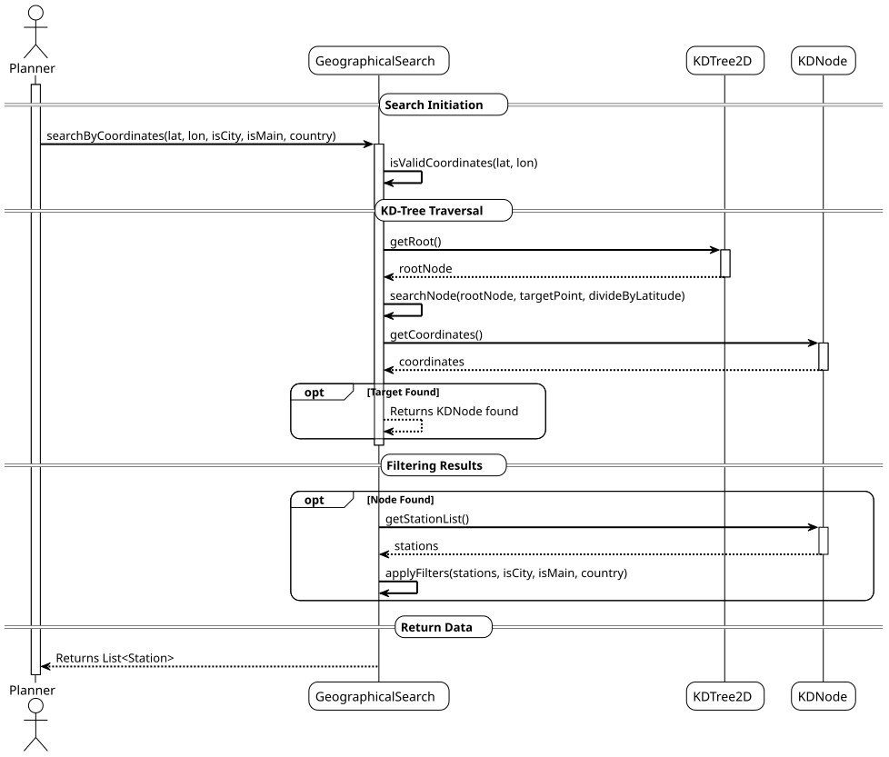
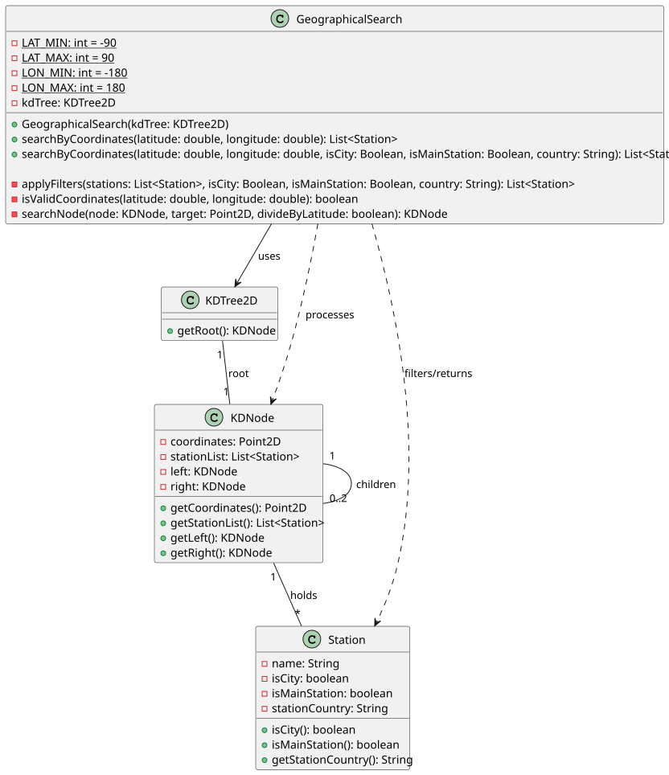

# USEI08 - Search by Geographical Area

## 3. Design

### 3.1. Systematization

According to the taken rationale and the provided implementation, the conceptual classes promoted to software classes are:

* **GeographicalSearch** (Controller/Service)
* **KDTree2D** (Data Structure)

### 3.2. Sequence Diagram (SD)

#### Full Diagram

This diagram shows the full sequence of interactions between the classes involved in the realization of this user story.

The Full Sequence Diagram shows all interactions between the USEI08 system classes, including:

#### **Main Classes:**

1. **GeographicalSearch** (Controller) - Responsible for orchestrating the search logic, traversing the KD-Tree, and applying filters.
2. **KDTree2D** - The data structure holding the station data.

#### **System Phases:**

##### **1. Search Initiation**
- The Planner provides coordinates (Latitude/Longitude) and optional filters (City, Main Station, Country).

##### **2. Tree Traversal (Search Strategy)**
- The system validates the coordinates.
- It accesses the root of the KD-Tree.
- It performs a recursive search (`searchNode`) pruning branches based on the 2D coordinates (alternating latitude/longitude splits).

##### **3. Filtering and Result**
- Once candidate stations are found in the tree node, a filtering process (`applyFilters`) is executed.
- The final list of `Station` objects is returned.

#### **Key Features:**

- **KD-Tree Pruning** - Avoids scanning the whole dataset by using the properties of the 2D-Tree.
- **Validation** - Ensures coordinates are within valid ranges (-90 to 90 Lat, -180 to 180 Lon).
- **Dynamic Filtering** - Allows filtering by multiple criteria simultaneously using Java Streams.

#### **Data Flow:**

1. **Input**: Latitude, Longitude, isCity, isMainStation, Country.
2. **Search**: Recursive traversal of `KDNode`s.
3. **Filter**: Check properties of the stations found.
4. **Output**: List of matching `Station` objects.

### 3.4. Class Diagram (CD)

