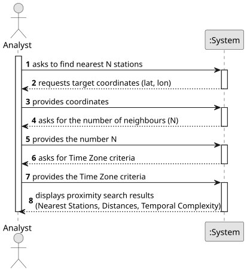

# USEI09 - Proximity Search (Nearest-N with Filters)

## 1. Requirements Engineering

### 1.1. User Story Description
As an analyst, I want to find the nearest N stations to a given (lat, lon) using the 2D-tree, with optional filters, so I can get accurate nearby results efficiently.

### 1.2. Customer Specifications and Clarifications

#### From the customer's clarifications:
> Question: Hello, Regarding USEI09, which aks for the N closest stations near a search point, we have 2 situations that need to be cleared. Since it is possible to have several stations with the same coordinates, how should we handle the scenario where we have a cluster of x stations sharing coordinates that are the closest to a search point p, but it is only asked to find for the n closest stations to this point. In this scenario n < x. Should we leave out stations even though they share the same coordinates? (On what criteria, the station name?)
        Or should we present all these stations even though they are more than what was asked?. In the acceptance criteria it is stated that "The search should enable optional filtering base on the time zone criteria". Is this the only filter needed in this functionality?
>
> Answer: Treat all stations that share the same (lat, lon) as one, even if that means returning more than N stations. Time zone is the only filter.

> Question: For the timezone filter, do we consider both timezone group and country, or only both of them? Can the user select more than one timezone to filter?
>
> Answer: Acceptance Criteria.
The search should enable optional filtering based on the time zone criteria.
> 
#### From the specifications document:
- Context: Users need the N closest stations to a target coordinate (e.g., for nearest major hubs). 2D-tree should minimize explored nodes
- Calculation: Use Haversine distance (km) with Earth radius between two (lat, lon) points.
- Data: The search operates on a real-world dataset of ≈ 64k European railway stations, indexed by a 2D-tree built on (latitude, longitude).
- Efficiency: The 2D-tree must support range and nearest-neighbour operations much faster than scanning all stations.

### 1.3. Acceptance Criteria
- **AC1:** Use Harvesine Distance with Earth radius between two (lan,lon) points.
- **AC2:** The search should enable optional filtering based on a time zone criteria.

### 1.4. Found Dependencies
- **USEI6** : Requires the definition and validation of the station data (latitude, longitude, time zone group, etc.).
- **USEI07** : This US requires a successfully built, balanced 2D-Tree on (Latitude/Longitude) to perform the spatial query.

### 1.5. Input and Output Data

#### Input Data:

  - Target Coordinates ( Latitude [lat] and Longitude [lon] ) of the search origin;
  - Number of Neighbours (N);
  - Filter based on Time Zone;

#### Output Data:
- Nearest N Stations;
- The Harvesine Distance in kilometers for each returned station;
- The temporal complexity analysis of the algorithm used;

### 1.6. System Sequence Diagram (SSD)

**_Other alternatives might exist._**

### 1.7. Other Relevant Remarks
- None.