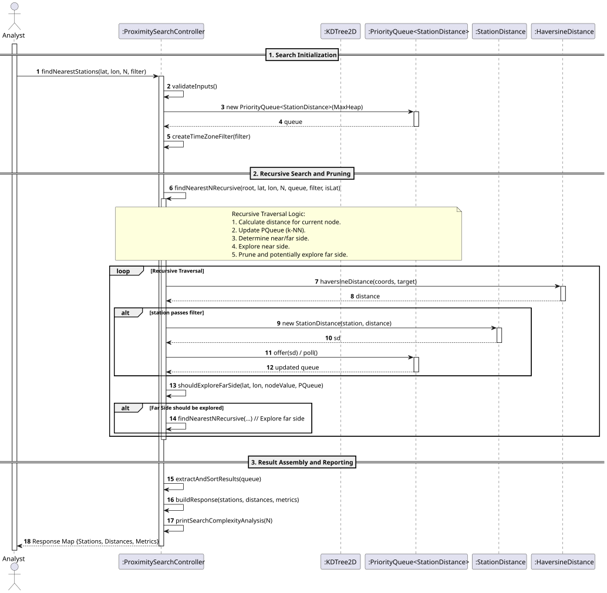
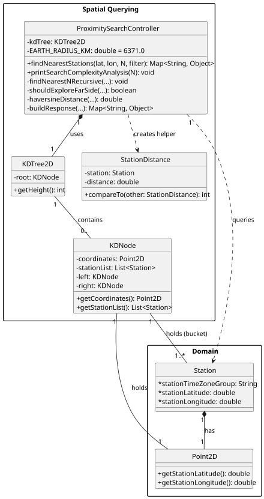

# USEI09 - Proximity Search (Nearest-N with Filters)

## 3. Design

### Systematization ##

According to the taken rationale, the conceptual classes promoted to software classes are:

* ProximitySearchController;
* KDTree2D;
* KDNode;

There is also a service class : PackingHeuristic

## 3.2. Sequence Diagram (SD)

### Full Diagram

This diagram shows the full sequence of interactions between the classes involved in the realization of this user story.

The Full Sequence Diagram shows all interactions between the USEI09 system classes, including:

#### **Main Classes:**

1. **ProximitySearchController** (Control) - Orchestrates the k-NN search
2. **KDTree2D** (Data Structure) -  The primary data structure (implicit in traversal).
3. **PriorityQueue<StationDistance>** (Entity) -  The Max Heap used to store the N nearest neighbors found so far, enabling the pruning logic.
4. **StationDistance** (Value Object) - A temporary object coupling a station with its calculated distance.

#### **System Phases:**

##### **1. Search Initialization**
- Analyst invokes `findNearestStations(lat, lon, N, filter)` on the Controller.
- The Controller validates input (N>0) and initializes the PriorityQueue (Max Heap) and the time zone filter predicate.

##### **2. Recursive Search**
- The Controller initiates the recursive traversal (`findNearestNRecursive`) starting from the KD-Tree root.
- At each node, the HaversineDistance utility is used to calculate the distance between the node's station and the target coordinates.
- The calculated distance is compared against the maximum distance in the PriorityQueue (the Nth neighbor). The queue is updated to maintain the N closest points.
- The method checks if the far side of the splitting plane can contain a closer point than the farthest current neighbor. If not, the far side branch is pruned, minimizing nodes explored.
- The Time Zone filter is applied before a station is considered for insertion into the Priority Queue.

##### **3. Result**
- Once the recursion completes, the Controller extracts the stations and distances from the PriorityQueue and sorts them into ascending order.
- The Controller calls `buildResponse` to assemble the final result map, including performance metrics.
- The system returns all the neighbours, as well as the temporal complexity.
### 3.3. Other Observations
None.
## 3.4. Class Diagram (CD)

