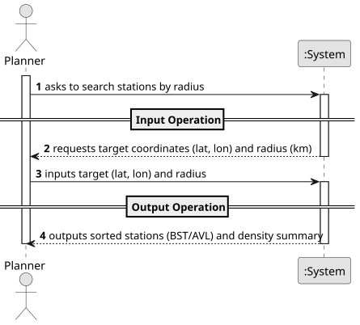

# USEI10 - Radius search and density summary

## 1. Requirements Engineering

### 1.1. User Story Description

As an operations planner, I want to fetch all stations within a radius R (km) of a target (lat, lon) using the 2D-tree, and get a summary by country and by isCity, so I can assess local coverage.

### 1.2. Customer Specifications and Clarifications

**From the document specifications:**

> **Context:** Operational questions often ask, "what stations lie within R km of a point?" and "how are they distributed by country and isCity?" We need both the list and a quick summary.
> **Acceptance Criteria:** Use Haversine distance (km) with Earth radius between two (lat,lon) points. Returns: A BST/AVL tree sorted by distance (ASC), and station name (DESC); Temporal analysis complexity.

### 1.3. Acceptance Criteria

> **1.** The search must accept a target geographical point (latitude and longitude) and a radius $R$ in kilometers.
> **2.** The distance calculation must utilize the **Haversine formula** considering the Earth's radius.
> **3.** The system must return a list of stations (organized in a BST or AVL tree) that fall within the specified radius.
> **4.** The results must be sorted primarily by **distance (Ascending)** and secondarily by **station name (Descending)**.
> **5.** The system must provide a density summary of the found stations, aggregated by **country** and **isCity** status (e.g., count of stations in PT that are Cities, etc.).
> **6.** The solution should provide the temporal analysis complexity of the operation.

### 1.4. Found out Dependencies

> Dependency on the structure **KDTree2D** to perform the spatial search efficiently.
> Dependency on a **BST** or **AVL** structure to organize and return the sorted results as requested.

### 1.5 Input and Output Data

**Input Data:**
- **Target Coordinates:**
    - Latitude (`lat`)
    - Longitude (`lon`)
- **Search Range:**
    - Radius in Kilometers (`radius`)

**Output Data:**
- A data structure (BST/AVL) containing the stations within the radius, sorted by distance (ASC) and name (DESC).
- A summary map/list showing the distribution of these stations by Country and City status (e.g., `Map<String, Integer>` or similar).

### 1.6 System Sequence Diagram (SSD)

The System Sequence Diagram shows the interactions between the Planner and the System for the radius search operation.

### 1.7 Other Relevant Remarks

#### **Main Operations:**

1. **Input Operation**
    - The Planner inputs the target coordinates (latitude/longitude) and the desired radius in km.

2. **Output Operation**
    - The System calculates distances using the Haversine formula.
    - The System queries the KD-Tree to find matching stations.
    - The System returns the stations sorted (Distance ASC, Name DESC) and the density summary.