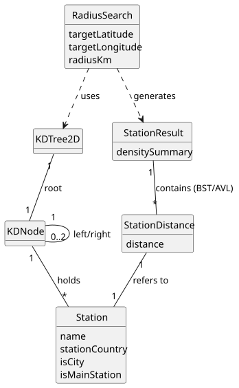

# USEI10 - Radius search and density summary

## 2. Analysis

### 2.1. Relevant Domain Model Excerpt

### 2.2. Other Remarks

**Algorithmic Considerations:**
* **Search Mechanism:** The system continues to utilize the **KD-Tree (2-Dimensional)** to perform the spatial search. The search algorithm must implement **pruning** based on the Euclidean distance (or an approximation) to the splitting planes to avoid searching subtrees that are strictly outside the radius $R$.
* **Distance Calculation:** Unlike the rectangular area search, this use case requires the **Haversine Formula** to calculate the precise great-circle distance between the target point and station nodes, considering the Earth's curvature (Earth Radius $\approx$ 6371 km).

**Data Structure & Sorting Logic:**
* **Output Structure:** According to the requirements, the filtered stations must be returned in a **BST (Binary Search Tree) or AVL Tree**.
* **Sorting Criteria:** The tree nodes must be ordered primarily by **Distance (Ascending)** and secondarily by **Station Name (Descending)**.
* **Density Summary:** A secondary process (or parallel accumulation during search) is required to aggregate counts by `Country` and `isCity` status (e.g., using a Map structure).

**Complexity Analysis:**
* The temporal complexity of the range search in a KD-Tree is typically $O(\sqrt{n} + k)$, where $n$ is the number of nodes and $k$ is the number of reported points.
* The construction of the result BST/AVL adds a complexity of $O(k \log k)$.