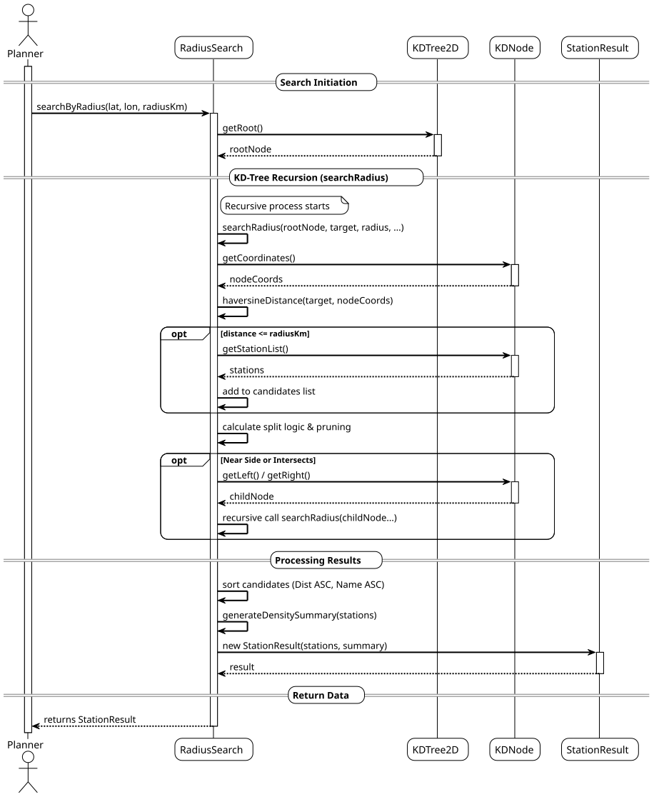
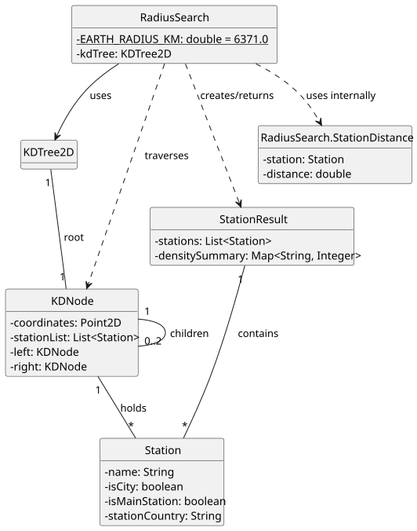

# USEI10 - Radius search and density summary

## 3. Design

### 3.1. Systematization

According to the taken rationale and the provided implementation, the conceptual classes promoted to software classes are:

* **RadiusSearch** (Controller/Service)
* **KDTree2D** (Data Structure)
* **StationResult** (DTO - Data Transfer Object)

### 3.2. Sequence Diagram (SD)

#### Full Diagram

This diagram shows the full sequence of interactions between the classes involved in the realization of this user story.

The Full Sequence Diagram shows all interactions between the USEI10 system classes, including:

#### **Main Classes:**

1. **RadiusSearch** (Controller) - Responsible for orchestrating the radius search, calculating Haversine distances, and aggregating results.
2. **KDTree2D** - The data structure holding the station data.

#### **System Phases:**

##### **1. Search Initiation**
- The Planner provides the target coordinates (Latitude/Longitude) and the search radius (Km).
- The `RadiusSearch` controller initializes the search.

##### **2. Tree Traversal (Search Strategy)**
- The system accesses the root of the KD-Tree.
- It performs a recursive search (`searchRadius`).
- **Distance Calculation:** It calculates the **Haversine distance** between the target and the current node.
- **Pruning:** It determines if subtrees need to be searched by comparing the perpendicular distance to the splitting plane against the radius (converting degrees to approx. km).

##### **3. Processing and Aggregation**
- **Sorting:** The candidate list is sorted by Distance (Ascending) and then by Station Name.
- **Density Summary:** The system iterates through the found stations to generate a map counting stations by `Country` and `isCity` status (`generateDensitySummary`).

#### **Key Features:**

- **Haversine Formula** - accurate distance calculation considering Earth's curvature ($R \approx 6371$ km).
- **Efficient Pruning** - Reduces complexity by skipping tree branches outside the target radius.
- **Result Encapsulation** - Returns a `StationResult` containing both the list and the statistical summary.

#### **Data Flow:**

1. **Input**: Target Latitude, Target Longitude, Radius (km).
2. **Search**: Recursive traversal of `KDNode`s with distance checks.
3. **Sort & Aggregate**: Ordering results and counting by category.
4. **Output**: `StationResult` object.

### 3.4. Class Diagram (CD)

