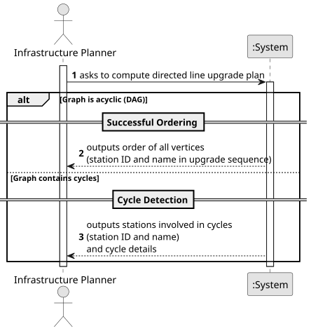

# USEI11 - Directed Line Upgrade Plan

## 1. Requirements Engineering

### 1.1. User Story Description

As an infrastructure planner, I need to compute an ordering of Belgian stations based on the directed track dependencies so I can schedule station upgrades in an order that respects all directional dependencies; and if such an order does not exist because of cycles, I want to see which stations and links are involved in those cycles.

### 1.2. Customer Specifications and Clarifications

**From the document specifications:**

> **Context:** Assume that the Belgian rail edges define directional dependencies for an upgrade or signaling project where each directed edge A→B means: "Before station B can be fully upgraded, its incoming neighbors (like A) must be upgraded first," e.g., to ensure compatibility, signaling, or control dependencies flow in the traffic direction.
>
> **Algorithm:** Topological Sort is used to compute a valid ordering of stations. If the graph contains cycles, topological sort will fail, and cycle detection is performed to identify problematic stations.

### 1.3. Acceptance Criteria
 N/a

### 1.4. Found out Dependencies

> Dependency on the **Graph** structure representing the railway network as a directed graph.
>
> Dependency on **Topological Sort** algorithm for ordering vertices.
>
> Dependency on **Cycle Detection** algorithm when topological sort fails.

### 1.5 Input and Output Data

**Input Data:**
- The Railway Network Graph (directed).

**Output Data:**

**Case 1 - Graph without cycles (Success):**
- Order of all vertices (complete list of stations in upgrade order)

**Case 2 - Graph with cycles (Failure):**
- Stations involved in cycles (list of all unique stations that are part of any cycle)
- Cycle details (showing the circular paths)

### 1.6 System Sequence Diagram (SSD)

### 1.7 Other Relevant Remarks

#### **Main Operations:**

1. **Validation Operation**
    - The System verifies that the graph is directed.
    - The System checks that the network is loaded.

2. **Computation Operation**
    - The System attempts a topological sort on the directed graph.
    - If successful, returns the complete ordering.
    - If unsuccessful (cycles detected), performs cycle detection.

3. **Output Operation**
    - **Success:** The System outputs the complete list of stations in dependency order.
    - **Failure:** The System outputs the list of stations involved in cycles and shows the cycle paths.