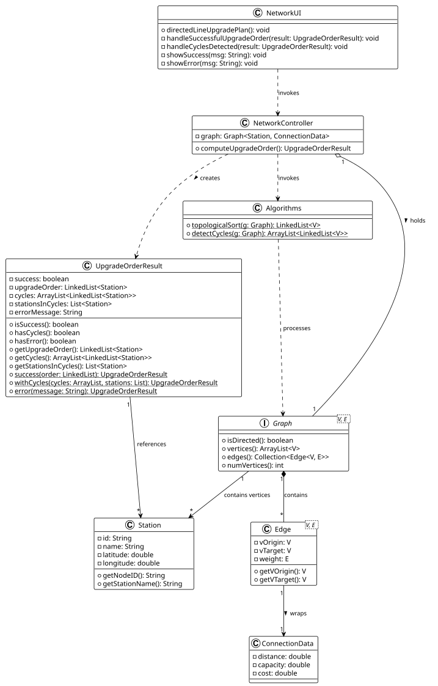

# USEI11 - Directed Line Upgrade Plan

## 2. Analysis (Domain Model)

### Domain Concepts

**NetworkUI:**
- Represents the user interface layer for the application.
- Displays the "Directed Line Upgrade Plan" option.
- Shows the results based on whether the graph is acyclic or contains cycles.
- Handles both success (upgrade order) and failure (cycles detected) scenarios.

**NetworkController:**
- Acts as the mediator between the UI and the domain logic.
- Manages the `Graph` containing `Station` vertices and `ConnectionData` edges.
- Invokes the `Algorithms` library to perform topological sort and cycle detection.
- Returns results encapsulated in an `UpgradeOrderResult` DTO.

**UpgradeOrderResult:**
- A Data Transfer Object (DTO) that encapsulates the result of the upgrade order computation.
- Contains either:
    - A successful upgrade order (LinkedList of stations)
    - Cycle information (list of cycles and stations involved)
    - An error message
- Provides factory methods for creating different result types.

**Algorithms:**
- A library of static graph algorithms.
- Implements:
    - `topologicalSort`: Computes a linear ordering of vertices in a DAG.
    - `detectCycles`: Identifies all cycles in a directed graph using DFS.
- Both methods use graph coloring (WHITE, GRAY, BLACK) for vertex state tracking.

**Station:**
- Represents a physical node in the rail network (Vertex).
- Identified by a unique ID (e.g., "335") and Name (e.g., "DRONGEN").
- Contains geographic coordinates for visualization purposes.

**ConnectionData:**
- Represents the edge information between stations.
- Contains distance, capacity, and cost attributes.
- For upgrade planning, the directional nature of the edge is the key factor.

**Graph:**
- Generic graph interface used to represent the railway network.
- Must be directed (`isDirected() == true`) for upgrade planning.
- Provides methods to traverse vertices and edges.