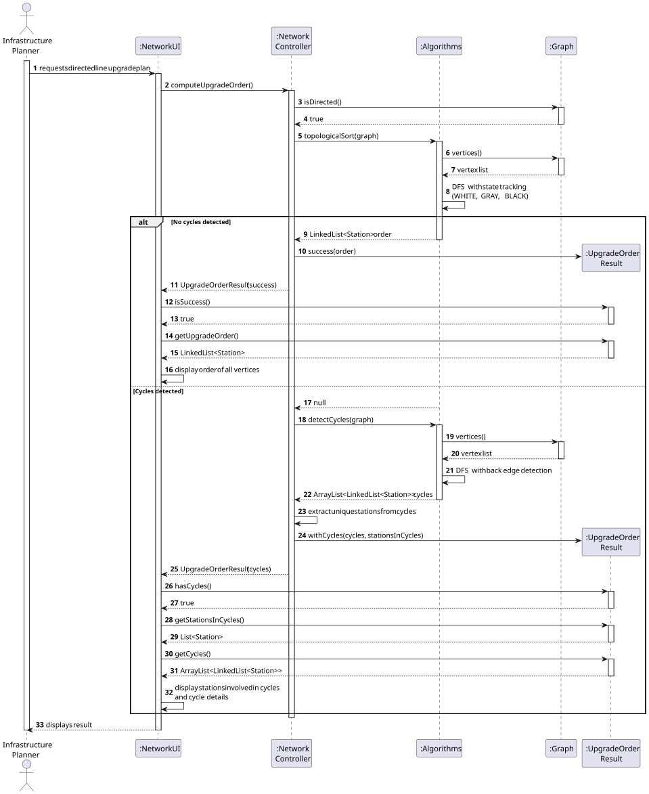
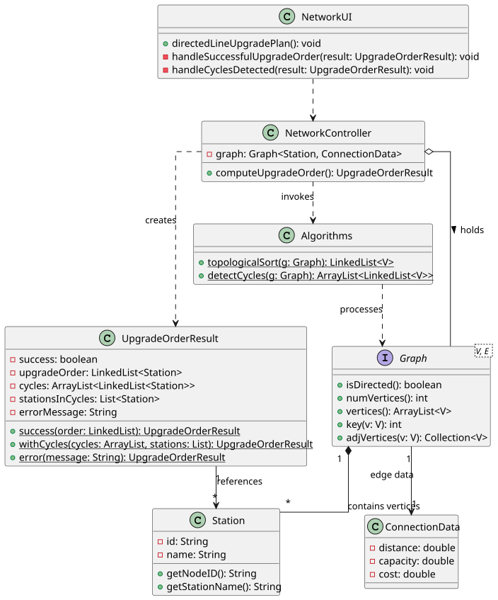

# USEI11 — Directed Line Upgrade Plan

## 3. Design

### 3.1. Rationale

The complexity of this User Story lies in determining a valid ordering for station upgrades based on directional dependencies, and handling the case where circular dependencies make such an ordering impossible.

To maintain separation of concerns:
* **Generic Algorithms:** The core graph algorithms (topological sort and cycle detection) are implemented in the static `Algorithms` library, keeping them reusable and domain-independent.
* **Controller Logic:** The `NetworkController` handles the specific business logic of applying these algorithms to the railway network and interpreting the results.
* **Data Encapsulation:** The `UpgradeOrderResult` DTO is used to transfer the computation results (either success with ordering, or failure with cycle information) from the controller to the UI.

The implementation uses a two-phase approach:
1. **Phase 1:** Attempt topological sort. If successful, return the ordering.
2. **Phase 2:** If topological sort fails (returns null), perform cycle detection to identify the problematic dependencies.

---

### 3.2. Systematization

According to the project architecture, the implementation follows a layered approach:

- **UI Layer:** NetworkUI (Console interface).

- **Controller Layer:** NetworkController.

- **Domain Layer:** UpgradeOrderResult (DTO), Station, ConnectionData.

- **Infrastructure/Library:** Algorithms (Static Library), Graph (Generic Interface).

---

## 3.3. Sequence Diagram (SD)

### Full Diagram

This diagram shows the complete sequence of interactions for computing the upgrade order, including both success and failure paths.

---

## 3.4. Class Diagram (CD)

---

## 3.5. Algorithm Details

### Topological Sort Algorithm

**Approach:** Depth-First Search (DFS) with vertex coloring
- **WHITE (0):** Vertex not yet visited
- **GRAY (1):** Vertex currently being processed
- **BLACK (2):** Vertex fully processed

**Logic:**
1. For each unvisited vertex, perform DFS
2. If a GRAY vertex is encountered during DFS, a cycle exists (back edge)
3. Mark vertices as BLACK when fully processed
4. Add vertices to the front of the result list (reverse finish order)

**Result:**
- Returns `LinkedList<V>` if no cycles exist
- Returns `null` if cycles are detected

### Cycle Detection Algorithm

**Approach:** DFS with parent tracking
- Tracks parent relationships to reconstruct cycle paths
- Uses same coloring scheme as topological sort

**Logic:**
1. For each unvisited vertex, perform DFS
2. When a back edge is found (GRAY vertex encountered), reconstruct the cycle
3. Build cycle path by following parent pointers
4. Store all detected cycles

**Result:**
- Returns `ArrayList<LinkedList<V>>` containing all detected cycles
- Each cycle is a closed path (first vertex == last vertex)