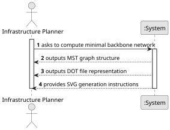

# USEI12 - Minimal Backbone Network

## 1. Requirements Engineering

### 1.1. User Story Description

As an infrastructure planner, I want to compute a minimum network over the rail network (treated as undirected) so that I can identify a minimal backbone that connects all stations with minimum total track length.

### 1.2. Customer Specifications and Clarifications

**From the document specifications:**

> **Context:** To estimate a cost baseline for maintenance or expansion, it is necessary to have a minimal track subset that connects all reachable stations.
>
> **Algorithm:** Minimum Spanning Tree (MST) algorithms like Prim's or Kruskal's are used to find the minimal subset of edges that connects all vertices with minimum total weight.
>
> **Weight Criterion:** Track distance (in kilometers) is used as the edge weight for determining the minimal network.

### 1.3. Acceptance Criteria
N/a

### 1.4. Found out Dependencies

> Dependency on the **Graph** structure representing the railway network.
>
> Dependency on **Minimum Spanning Tree algorithm** (Prim's algorithm) for computing the minimal backbone.
>
> Dependency on **Graphviz DOT format** for visualization export.

### 1.5 Input and Output Data

**Input Data:**
- The Railway Network Graph (treated as undirected)
- Edge weights (distance in kilometers)

**Output Data:**
- **A graph representing the Minimal Backbone Network** (MST graph structure)
- **DOT file representation** with:
    - Each vertex positioned at its XY coordinates
    - Edge weights (distances) labeled
    - Similar visual style to Belgium train global map
- **SVG file** generated from DOT file using Graphviz neato

### 1.6 System Sequence Diagram (SSD)

### 1.7 Other Relevant Remarks

#### **Main Operations:**

1. **Validation Operation**
    - The System verifies that the network is loaded.
    - The graph is treated as undirected for MST computation.

2. **Computation Operation**
    - The System applies Prim's algorithm to compute the MST.
    - Uses distance as the weight criterion.
    - Handles disconnected components (computes forest if necessary).

3. **Export Operation**
    - **DOT File:** The System exports the MST to DOT format with XY coordinates.
    - **Statistics:** The System calculates total distance, number of edges, and stations.
    - **SVG Generation:** Instructions provided for converting DOT to SVG/PNG.