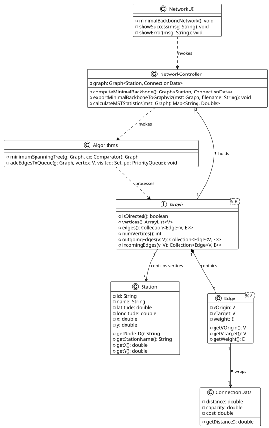

# USEI12 - Minimal Backbone Network

## 2. Analysis (Domain Model)

### Domain Concepts

**NetworkUI:**
- Represents the user interface layer for the application.
- Displays the "Minimal Backbone Network" option.
- Prompts the computation of the minimum spanning tree.
- Displays network statistics (total distance, number of edges, number of stations).
- Shows instructions for generating SVG visualization from DOT file.

**NetworkController:**
- Acts as the mediator between the UI and the domain logic.
- Manages the `Graph` containing `Station` vertices and `ConnectionData` edges.
- Invokes the `Algorithms` library to compute the MST using Prim's algorithm.
- Handles the export of the MST to Graphviz DOT format.
- Calculates statistics about the minimal backbone network.

**Algorithms:**
- A library of static graph algorithms.
- Implements `minimumSpanningTree()`: Computes MST using Prim's algorithm with a priority queue.
- Uses a comparator to determine edge weights (distance in this case).
- Treats the graph as undirected for MST computation.
- Returns a new undirected graph representing the MST.

**Station:**
- Represents a physical node in the rail network (Vertex).
- Identified by a unique ID (e.g., "335") and Name (e.g., "DRONGEN").
- Contains geographic coordinates (latitude, longitude) for real-world positioning.
- Contains XY coordinates for visualization in DOT/SVG format.

**ConnectionData:**
- Represents the edge information between stations.
- Contains three attributes:
    - `distance`: Track length in kilometers (used as weight for MST)
    - `capacity`: Maximum trains per day
    - `cost`: Operational cost
- For USEI12, the `distance` attribute is the key factor for minimizing track length.

**Graph:**
- Generic graph interface used to represent the railway network.
- For USEI12, the graph is treated as **undirected** (even if the original is directed).
- The MST algorithm works on an undirected version of the network.
- Provides methods to traverse vertices and edges.

### Key Domain Logic

**Minimum Spanning Tree Concept:**
- A spanning tree is a subgraph that:
    1. Connects all vertices
    2. Is a tree (no cycles)
    3. Has exactly V-1 edges (for V vertices in a connected component)
- A **minimum** spanning tree minimizes the total edge weight (distance in our case).

**Prim's Algorithm:**
- Greedy algorithm that builds the MST incrementally
- Starts from an arbitrary vertex
- Repeatedly adds the minimum-weight edge that connects a visited vertex to an unvisited vertex
- Guarantees an optimal (minimum) solution

**Application to Railway Network:**
- **Input:** Complete railway network with all connections
- **Output:** Minimal subset of tracks that:
    - Connects all reachable stations
    - Minimizes total track length
    - Provides a baseline for maintenance cost estimation