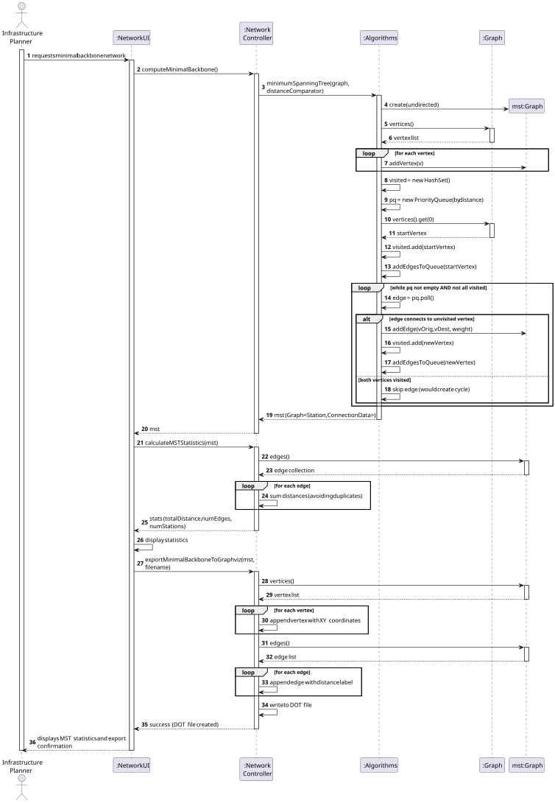
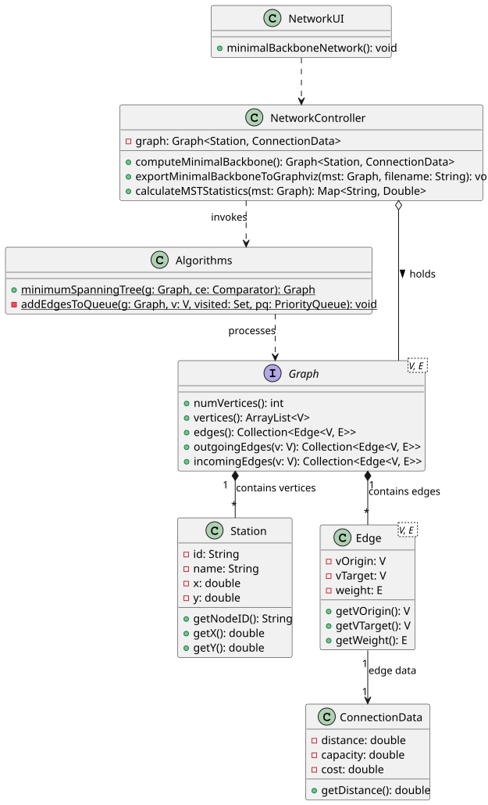

# USEI12 — Minimal Backbone Network

## 3. Design

### 3.1. Rationale

The complexity of this User Story lies in computing a minimum spanning tree (MST) that connects all railway stations with minimum total track length, while maintaining the ability to visualize the result geographically.

To maintain separation of concerns:
* **Generic Algorithms:** The core MST computation (Prim's algorithm) is implemented in the static `Algorithms` library, keeping it reusable and domain-independent.
* **Controller Logic:** The `NetworkController` handles the specific business logic of:
    - Applying the MST algorithm to the railway network
    - Using distance as the weight criterion
    - Exporting the result to DOT format with geographic coordinates
    - Calculating network statistics
* **Data Encapsulation:** The `Graph` interface abstracts the network structure, and `ConnectionData` encapsulates edge attributes.

The implementation uses **Prim's algorithm with a priority queue** because:
1. Efficient for both sparse and dense graphs: $\mathcal{O}(E \log V)$
2. Naturally handles weighted graphs with real-valued distances
3. Works well with geographically connected networks
4. Provides better cache locality than alternative algorithms

---

### 3.2. Systematization

According to the project architecture, the implementation follows a layered approach:

- **UI Layer:** NetworkUI (Console interface).

- **Controller Layer:** NetworkController.

- **Domain Layer:** Station, ConnectionData.

- **Infrastructure/Library:** Algorithms (Static Library), Graph (Generic Interface), Edge.

---

## 3.3. Sequence Diagram (SD)

### Full Diagram

This diagram shows the complete sequence of interactions for computing the minimal backbone network and exporting it for visualization.

---

## 3.4. Class Diagram (CD)

---

## 3.5. Algorithm Details

### Prim's Algorithm with Priority Queue

**Approach:** Greedy selection of minimum-weight edges

**Data Structures:**
- `Set<V> visited`: Tracks which vertices are in the MST
- `PriorityQueue<Edge<V, E>>`: Orders candidate edges by weight
- `Graph<V, E> mst`: The resulting minimum spanning tree

**Algorithm Steps:**

1. **Initialization:**
    - Create empty MST graph
    - Add all vertices to MST (no edges yet)
    - Mark arbitrary start vertex as visited
    - Add all edges from start vertex to priority queue

2. **Main Loop (until all vertices visited):**
    - Extract minimum-weight edge from priority queue
    - If edge connects visited to unvisited vertex:
        - Add edge to MST
        - Mark new vertex as visited
        - Add all edges from new vertex to priority queue
    - If both vertices already visited, skip edge (would create cycle)

3. **Termination:**
    - Loop ends when all vertices are visited OR priority queue is empty
    - Result is a minimum spanning tree (or forest if graph is disconnected)

**Key Properties:**
- **Greedy Choice:** Always selects minimum available weight
- **Optimal Substructure:** MST of G contains MST of subgraphs
- **Cut Property:** Minimum-weight edge crossing a cut is in some MST

**Why Priority Queue?**
- Efficiently extracts minimum-weight edge: $\mathcal{O}(\log E)$
- Overall complexity: $\mathcal{O}(E \log V)$
- Better than array-based Prim's ($\mathcal{O}(V^2)$) for sparse graphs

---

### 3.6. Export to DOT Format

The DOT export functionality positions each station at its XY coordinates, making the visualization geographically accurate.

**Key Features:**
- `pos` attribute with `!` suffix forces fixed positioning
- `neato` layout engine respects fixed positions
- Edge labels show distance in kilometers
- Color coding: nodes (red), edges (green)

**Visualization Pipeline:**
1. Compute MST → Graph structure
2. Export to DOT → `minimal_backbone.dot`
3. Run Graphviz → `neato -Tsvg minimal_backbone.dot -o minimal_backbone.svg`
4. View SVG → Geographic visualization of minimal network