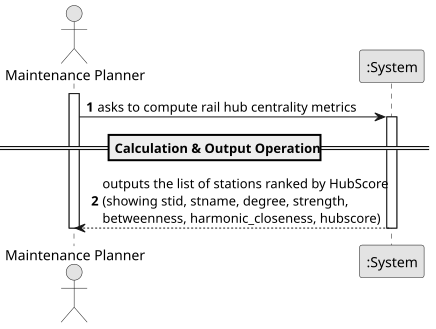

# USEI13 - Rail Hub Centrality Analysis

## 1. Requirements Engineering

### 1.1. User Story Description

As a maintenance planner, I want to compute centrality measures for each station, such as betweenness (shortest-path broking), harmonic closeness (accessibility), and strength/degree (direct connectivity), and combine them into a composite HubScore (normalised and weighted), so I can rank and export the network's hubs for decision-making.

### 1.2. Customer Specifications and Clarifications

**From the document specifications:**

> **Context:** Rail operations depend on a small set of hub stations that concentrate transfers, connect regions, and act as chokepoints. Identifying these hubs quantitatively helps with capacity planning, robustness (where failures have a significant impact), and prioritizing upgrades.
> **Formula:** The composite HubScore is calculated as:
> `hubscore = 0.35 * betw + 0.35 * harmonic_closeness + 0.30 * strengthNorm`
> **Normalization:** All scores are normalised to [0,1] per component.

### 1.3. Acceptance Criteria

### 1.4. Found out Dependencies

> Dependency on the **Graph** structure representing the railway network.
> 
> Dependency on shortest-path algorithms (e.g., Dijkstra or Floyd-Warshall) required to calculate Betweenness and Closeness centralities.

### 1.5 Input and Output Data

**Input Data:**
- The Railway Network Graph.

**Output Data:**
- A list of stations, ranked by HubScore, containing:
    - Station ID (`stid`)
    - Station Name (`stname`)
    - Degree
    - Strength
    - Betweenness Centrality (Normalized)
    - Harmonic Closeness Centrality (Normalized)
    - Composite HubScore

### 1.6 System Sequence Diagram (SSD)

### 1.7 Other Relevant Remarks

#### **Main Operations:**

1. **Calculation Operation**
    - The System traverses the graph to calculate degree/strength for all nodes.
    - The System executes pathfinding algorithms to determine shortest paths between all pairs to compute Closeness and Betweenness.
    - The System normalizes the results of each metric.
    - The System applies the weighted formula to derive the HubScore.

2. **Output Operation**
    - The System produces a ranked list/report of the "Hubs" based on the calculated scores.