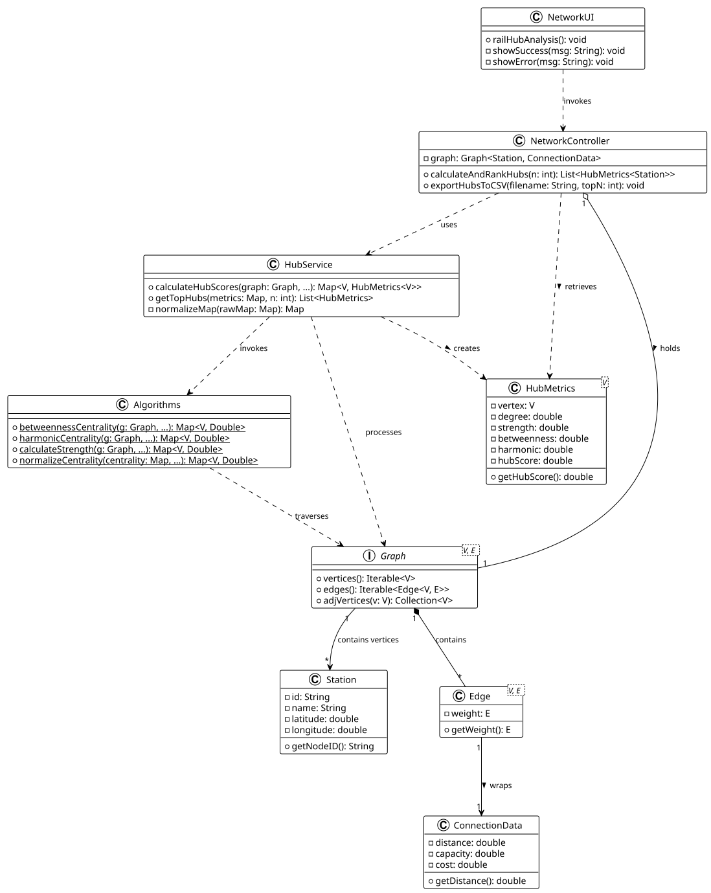

# USEI13 - Rail Hub Centrality Analysis

## 2. Analysis (Domain Model)

### Domain Concepts

**NetworkUI:**
- Represents the user interface layer for the application.
- Displays the "Rail Hub Centrality Analysis" option.
- Prompts the user for the number of hubs (N) to analyze.
- Displays the summary table of results and confirms the export of the CSV file.

**NetworkController:**
- Acts as the mediator between the UI and the domain logic.
- Manages the `Graph` containing `Station` vertices and `ConnectionData` edges.
- Invokes the `HubService` to perform the complex centrality calculations.
- Handles the specific formatting and writing of the "hubs_ranking.csv" file.

**HubService:**
- Encapsulates the specific business logic for rail hub identification.
- Orchestrates the execution of various graph algorithms (Betweenness, Harmonic Centrality, Strength) via the `Algorithms` library.
- Performs specific data normalization (e.g., normalizing Strength to [0,1]).
- Applies the specific business formula to compute the final `HubScore`:
  `score = (0.35 * betweenness) + (0.35 * harmonic) + (0.30 * strengthNorm)`.

**HubMetrics:**
- A Domain Transfer Object (DTO) designed to aggregate the calculated centrality measures for a specific station.
- It holds the specific values for Degree, Strength, Betweenness, Harmonic Closeness, and the composite HubScore.
- Allows the controller to sort and rank stations based on the final score.

**Algorithms:**
- A library of static graph algorithms used to compute raw metrics.
- Implements the mathematical logic for:
    - `betweennessCentrality`: Shortest-path brokerage.
    - `harmonicCentrality`: Accessibility/Closeness.
    - `calculateStrength`: Sum of edge weights (distances).
    - `normalizeCentrality`: Adjusts raw centrality values based on graph size.

**Station:**
- Represents a physical node in the rail network (Vertex).
- Identified by a unique ID (e.g., "335") and Name (e.g., "DRONGEN").

**ConnectionData:**
- Represents the edge weight information between stations.
- For this specific analysis, the `distance` attribute is extracted to weight the graph connections.