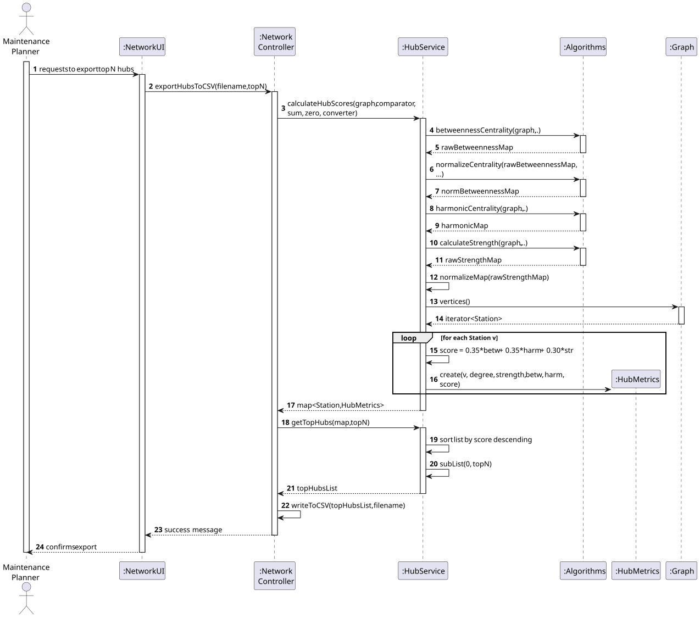
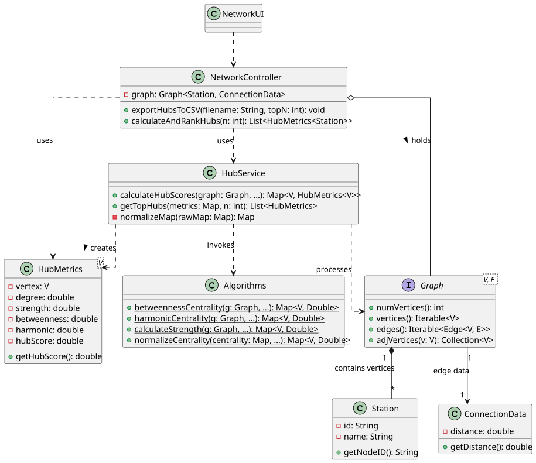

# USEI13 — Rail Hub Centrality Analysis

## 3. Design

### 3.1. Rationale

The complexity of this User Story lies in the aggregation of three distinct graph centrality metrics (Betweenness, Harmonic Closeness, and Strength) into a single composite "HubScore".

To maintain separation of concerns:
* **Generic Algorithms:** The core mathematical calculations for centrality are delegated to the static `Algorithms` library, keeping the graph logic generic.
* **Domain Logic:** A dedicated `HubService` is introduced to handle the domain-specific requirements: normalizing the diverse scales of these metrics (e.g., strength vs. normalized betweenness) and applying the specific business weighting formula ($0.35 \times Betw + 0.35 \times Harm + 0.30 \times Str$).
* **Data Encapsulation:** The `HubMetrics` DTO is used to transfer the full set of scores for a station, facilitating the ranking and export process.

---

### 3.2. Systematization

According to the project architecture, the implementation follows a layered approach:

- **UI Layer:** NetworkUI (Console interface).

- **Controller Layer:** NetworkController.

- **Domain Layer:** HubService (Domain Service), HubMetrics (DTO), Station, ConnectionData.

- **Infrastructure/Library:** Algorithms (Static Library), Graph (Generic Interface), Edge.

---

## 3.3. Sequence Diagram (SD)

### Full Diagram

This diagram shows the full sequence of interactions to calculate, rank, and export the top hubs.

---

## 3.4. Class Diagram (CD)

