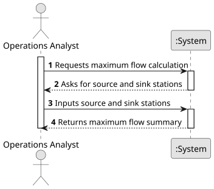

# USEI14 — Maximum throughput between two Hubs

## 1. Requirements Engineering

### 1.1. User Story Description

As an operations analyst, I want to compute the maximum flow between two selected stations
(source and sink), given per-edge capacities, so I can estimate the corridor’s theoretical throughput.

### 1.2. Customer Specifications and Clarifications

**From the document specifications:**

> **Context:** Major hubs’ effectiveness is reliant on the connecting corridors, and due to limited
> track capacity, it is crucial for planners to understand the maximum possible throughput between hubs.
> This understanding aids in validating schedules, recognizing bottlenecks, and prioritizing upgrades. 
> By calculating the maximum flow, planners can establish a credible upper limit on train routing per day.

### 1.3. Acceptance Criteria

> This User Story must implement one of the maximum flow algorithms learnt during ESINF classes.
> The algorithm can be either the Edmonds-Karp algorithm or the Ford-Fulkerson algorithm.

### 1.4. Found out Dependencies

> Dependency on the **Graph** structure representing the railway network.
> Dependency on graph traversal algorithms (e.g., BFS or DFS) required to find augmenting paths.

### 1.5 Input and Output Data

**Input Data:**
- The Railway Network Graph
- The source vertex (station)
- The sink vertex (station)

**Output Data:**
- The maximum flow summary:
    - Source Station ID (`source_stid`)
    - Sink Station ID (`target_stid`)
    - Maximum Flow Value (`maxFlowValue`)
- Time complexity analysis.

### 1.6 System Sequence Diagram (SSD)

### 1.7 Other Relevant Remarks

#### **Main Operations:**

1. **Path Finding Algorithm:**
    - The system uses DFS to find the augmentation path from source to sink.

2. **Get Path Bottleneck:**
    - The system identifies the minimum capacity edge along the found path (bottleneck).

3. **Update Residual Graph:**
    - The system updates the capacities along the path in the residual graph.

4. **Output Operation:**
    - The system produces a summary report of the maximum flow value between the selected stations.