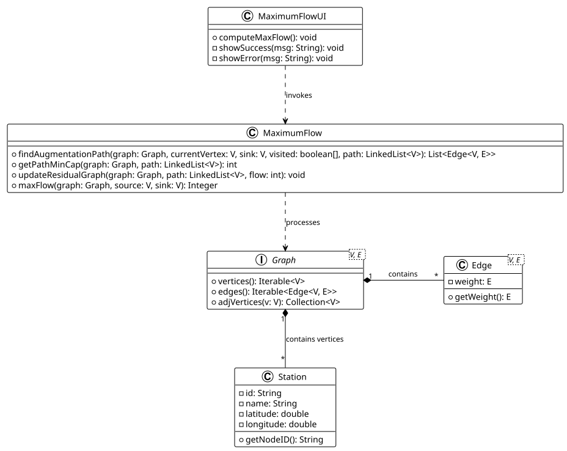

# USEI14 — Maximum throughput between two Hubs

## 2. Analysis (Domain Model)

### Domain Concepts

**MaximumFlowUI:**
- Represents the user interface layer for the application.
- Displays the "Maximum Throughput Between Two Hubs" option.
- Prompts the user to input the source and target hub IDs.
- Displays the calculated maximum throughput summary.

**MaximumFlow:**
- Encapsulates the specific business logic for calculating maximum throughput between two hubs.
- Manages the `Graph` containing `Station` vertices and `ConnectionData` edges.
- Invokes the methods in the order needed to compute the maximum flow using the Edmonds-Karp algorithm.

**Station:**
- Represents a physical node in the rail network (Vertex).
- Identified by a unique ID (e.g., "335") and Name (e.g., "DRONGEN").