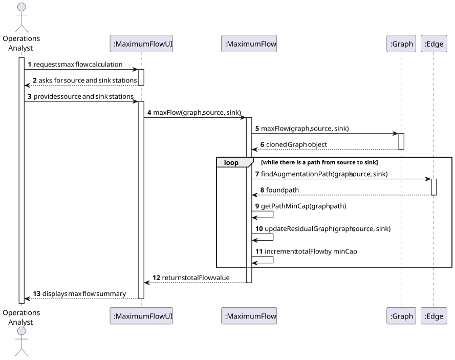
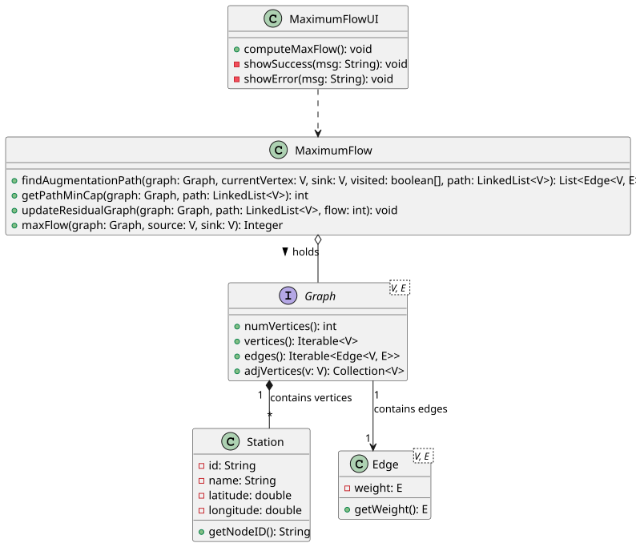

# USEI14 — Maximum throughput between two Hubs

## 3. Design

### 3.1. Rationale

The complexity of this User Story lies in calculating the maximum throughput between two rail hubs,
which involves finding the maximum flow in a weighted graph.

### 3.2. Systematization

According to the project architecture, the implementation follows a layered approach:

- **UI Layer:** MaximumFlowUI (Console interface).
- **Controller Layer:** MaximumFlow.
- **Domain Layer:** Station.
- **Infrastructure/Library:** Graph (Generic Interface), Edge, Algorithms (Static Library).

### 3.3. Sequence Diagram (SD)

This diagram shows the full sequence of interactions to calculate the maximum flow between two hubs.

## 3.4. Class Diagram (CD)

