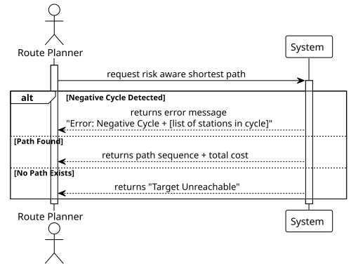

# USEI15 - Risk-Aware Shortest Path

## 1. Requirements Engineering

### 1.1. User Story Description

> As a route planner, I want to compute the shortest path between two stations using an edge cost that includes distance
and penalties, and detect if an inconsistent (negative cycle) exists, so I can propose robust routes or flag
configuration errors.

---

### 1.2. Customer Specifications and Clarifications

**From the document specifications:**

- **Context:** Some track connections may be slower or less reliable due to works or constraints.
We assign each edge a "cost" that combines distance and penalty/bonus.
This cost can be negative for highly preferred links, which require an algorithm beyond Dijkstra.

- **Cost Nature:** This cost can be negative for highly preferred links (bonuses), which requires an algorithm beyond Dijkstra
(which only supports non-negative weights).

- **Goal:** Compute the path with the minimum accumulated cost and identify negative cycles if they exist.

**From the client clarifications:**

- **Algorithm Selection:** Since the dataset contains edges with negative costs (e.g., `-3.41`), the **Bellman-Ford** 
algorithm must be used. Dijkstra's algorithm is not applicable as it relies on the assumption that adding an edge never
decreases the path cost, which is false here.

- **Graph Directionality:** The provided dataset (`lines.csv`) defines connections in a single direction (A -> B) without
symmetric counterparts. To avoid creating immediate trivial negative cycles (where A -> B is -5 and B -> A is -5, resulting
in a loop of -10), the graph must be treated as **Directed**.

- **Cost Source:** The `cost` attribute is directly available in the provided data files (`lines.csv`) and does not
require runtime calculation using a custom formula.

---

### 1.3. Expected Returns

1. Path Output: formatted output (depart_stid, cost, interm_stid1, cost,..., interm_stidn, cost, target_stid);
2. Total Cost: the sum of all edges weights in the path;
3. Error Handling: If a negative cycle is accessible from the source:
    - Return a specific error message/flag;
    - Identify the stations and edges involved in the cycle.
4. Performance Analysis: Asymptotic time complexity analysis of the solution.

---

### 1.4. Found out Dependencies

- **USEI12 (Minimal Backbone) / Data Loader:** This US depends on the graph being correctly loaded into memory from the
`stations.csv` and `lines.csv` files.
- **Graph Structure:** Depends on the implementation of a generic `Graph` interface (Edge List or Adjacency List)
capable of storing `Double` weights.

---

### 1.5 Input and Output Data

**Input Data:**
- `originStation`: The Station ID (or Object) to start the path.
- `targetStation`: The Station ID (or Object) to end the path.
- `Graph`: The directed graph structure loaded with stations and lines (with costs).

**Output Data:**
- **Success Scenario**: An object or string containing the ordered list of stations and their accumulated costs.
- **Failure Scenario (Negative Cycle)**: A list of stations comprising the negative loop detected.
- **Failure Scenario (No Path)**: A string indicating that no path exists between the two stations.

---

### 1.6. System Sequence Diagram (SSD)

---

### 1.7. Complexity Analysis (Theoretical)

- **Time Complexity O(V + E)**

The Bellman-Ford algorithm runs in O(VE) time, where V is the number of vertices *(stations)* and E is the number of edges *(lines)*.
This is because it relaxes all E edges V - 1 times.
The negative cycle check adds one more iteration over E, maintaining the complexity class.

- **Space Complexity O(V)**

To store the `distance` array (accumulated costs) and the `predecessor` array (for path reconstruction).