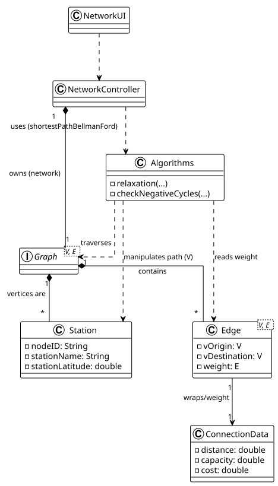

# USEI15 - Risk-Aware Shortest Path

## 2. Analysis (Domain Model)

### Domain Concepts

**RoutePlannerController:**
- Responsible for the interaction between the user interface and the business logic.
- Receives the request to calculate the path (origin and target station IDs).
- Invokes the appropriate service at `FreightNetwork`.
- Returns the formatted result or error messages.

**FreightNetwork:**
- Represents the complete freight network and acts as the domain's principal aggregation.
- It encapsulates the graph's data structure (containing all stations and lines).
- It is responsible for archestrating the optimization operations, instantiating the algorithm `BellmanFord` and
providing it with the graph populated with the data loaded from the dataset.

**Station:**
- Represents a physical node in the rail network (station, terminal, or freight yard).
- In the context of the graph, it acts as a Vertex.
- It is identified by a unique ID and has geographic and Cartesian coordinates (XY) used for visualization and 
distance calculation.

**Line:**
- Represents the physical connection (rails) between two stations.
- It contains the business attributes described in the statement, specifically distance, capacity, and critical 
attribute (a combined metric that can be negative due to bonuses/penalties).

**BellmanFord:**
- A specialized algorithmic strategy class.
- Implements the logic to calculate the minimum cost path in a graph with negative weights and detect negative cycles.
- Performs edge relaxation.
- Sometimes, it performs an additional check to identify inconsistencies in the network, as required by the requirements.

**Edge:**
- It is the structural element of the graph that connects two vertices (`Station`).
- It wraps the domain object `Line`.
- The method `getWeight()` exposes the value of the `cost` associated row attribute, allowing the shortest path algorithm 
to operate on numerical values (positive or negative).

**PathResult:**
- A data transfer object (DTO) created to encapsulate the complex result of the route calculation operation.
- It aggregates three fundamental elements required by the use case: 
  1. The ordered sequence of stations (the path)
  2. The total accumulated cost
  3. The indication of success or failure (including the list of stations involved in a possible negative loop)