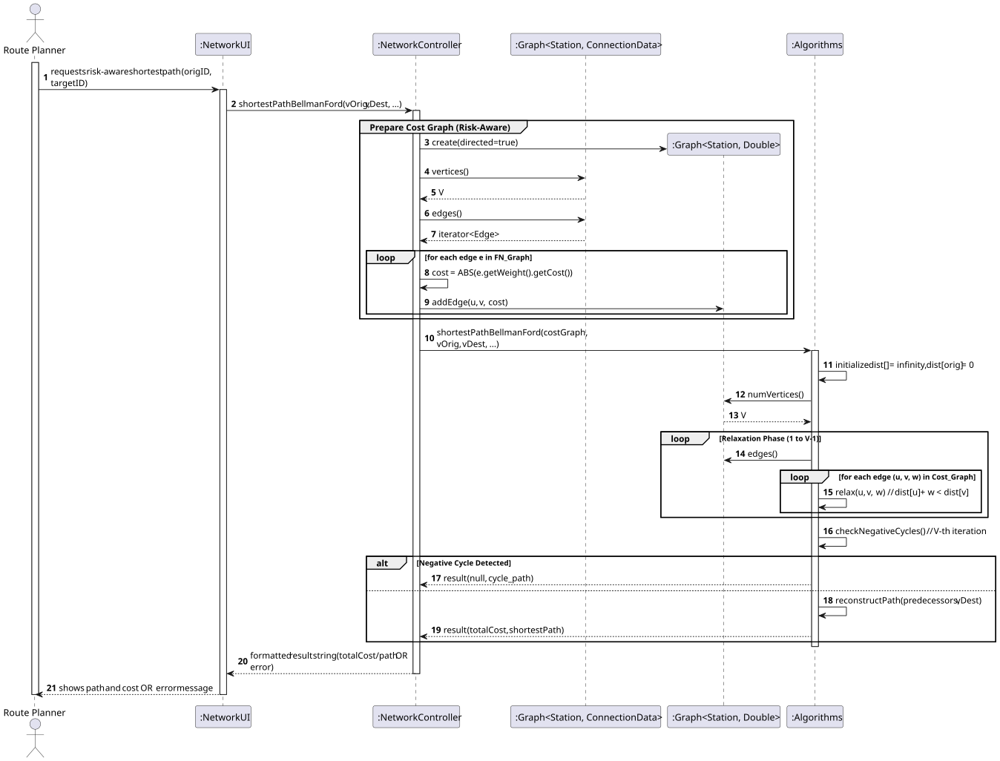
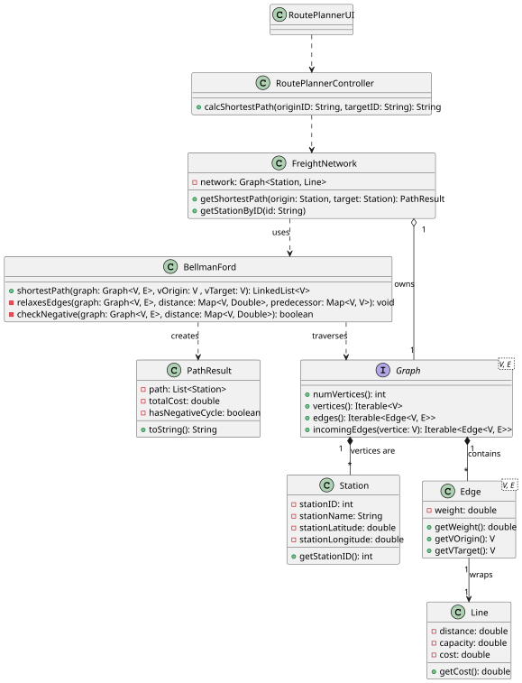

# USEI15 — Risk-Aware Shortest Path

## 3. Design

### 3.1. Rationale

The main challenge of this User Story is the existence of negative costs in the network edges (representing bonuses 
or preferred links), which invalidates the use of the standard Dijkstra algorithm. Furthermore, the system must 
explicitly detect negative cycles to flag configuration errors.

---

### 3.2. Systematization

According to the project architecture, the implementation follows a layered approach:

- **UI Layer:** NetworkUI (Console interface).

- **Controller Layer:** NetworkController.

- **Domain Layer:** ConnectionData, Station, Algorithms, Edge.

- **Infrastructure/Library:** Graph (Generic Interface).

---

## 3.3. Sequence Diagram (SD)

### Full Diagram

This diagram shows the full sequence of interactions between the classes involved in the realization of this user story.

---

## 3.4. Class Diagram (CD)

